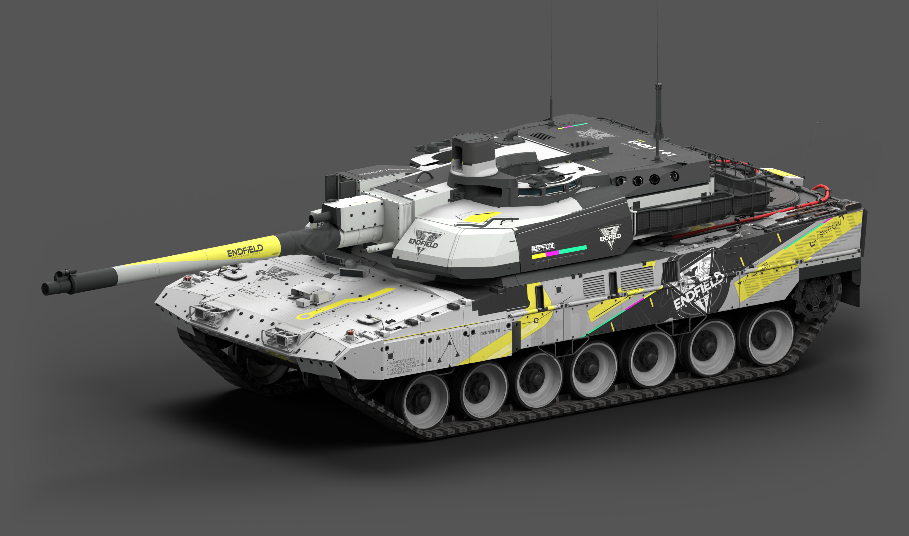

# 战争雷霆 · 涂装作品集

**[在线作品集与各套涂装的 3D 预览](https://icyryna.github.io/war-thunder-liveries/)**

点击下方任一作品标题，进入内嵌对应模型和涂装的介绍页；下载与原有评价保留。

**[下载 Windows 本地涂装工作台](https://github.com/IcyRyna/war-thunder-skin-skills/releases/tag/wt-paint-workbench/v1.0.0)**：完整解压，双击启动；无需预装 Python、Git 或 Blender，首次联网自动准备依赖。制作前请先告诉 AI 可以使用此工作台预览和检查涂装，并提供工具解压路径。编辑功能在本地，线上保留纯 3D 预览。

飞机与地面载具的游戏涂装、可编辑工程和完整展示。
选一件作品，先看整车效果，再下载对应的游戏包或分层源码。

**[地面载具](#地面载具) · [飞机涂装](#飞机涂装) · [试作与历史方案](#试作与历史方案) · [安装指南](docs/installation.md) · [下载怎么选](docs/downloads.md)**

## 地面载具

终末地主题以黑、白、黄构成工业风格；SPECTRE42 采用炭黑哑光与克制的黄青色标。各作品按载具真实表面重新安排图形。作品页提供七视图和独立整车大图。

| 作品 | 状态 | 获取 |
| --- | --- | --- |
| [豹 2A7V · SPECTRE42「炭灰分区」](https://icyryna.github.io/war-thunder-liveries/works/leopard2a7v-spectre42/) | 已获准发布 | [查看下载](https://github.com/IcyRyna/war-thunder-liveries/releases/tag/works/leopard2a7v-spectre42/current) |
| [10式「玄铁」· S42](https://icyryna.github.io/war-thunder-liveries/works/type10-xuantie-s42/) | 已获准发布 | [查看下载](https://github.com/IcyRyna/war-thunder-liveries/releases/tag/works/type10-xuantie-s42/current) |
| [ZTZ99A · SPECTRE42「磨砂炭灰」](https://icyryna.github.io/war-thunder-liveries/works/ztz99a-spectre42/) | 已确认可发布 | [查看下载](https://github.com/IcyRyna/war-thunder-liveries/releases/tag/works/ztz99a-spectre42/current) |
| [豹 2A6HEL · SPECTRE42「炭灰钢装」](https://icyryna.github.io/war-thunder-liveries/works/leopard2a6hel-spectre42/) | 已确认可发布 | [查看下载](https://github.com/IcyRyna/war-thunder-liveries/releases/tag/works/leopard2a6hel-spectre42/current) |
| [勒克莱尔 AZUR · SPECTRE42](https://icyryna.github.io/war-thunder-liveries/works/leclerc-azur-spectre42/) | 修订中 | [查看下载](https://github.com/IcyRyna/war-thunder-liveries/releases/tag/works/leclerc-azur-spectre42/current) |
| [EMBT · 终末地｜德国／法国](https://icyryna.github.io/war-thunder-liveries/works/embt-endfield/) | 已认可 | [查看下载](https://github.com/IcyRyna/war-thunder-liveries/releases/tag/works/embt-endfield/current) |
| [豹 2A7HU · 终末地](https://icyryna.github.io/war-thunder-liveries/works/leopard2a7hu-endfield/) | 已认可 | [查看下载](https://github.com/IcyRyna/war-thunder-liveries/releases/tag/works/leopard2a7hu-endfield/current) |
| [勒克莱尔 AZUR · 终末地「边界测绘」](https://icyryna.github.io/war-thunder-liveries/works/leclerc-azur-endfield/) | 初步成果 · 30分钟一轮直出 | [查看下载](https://github.com/IcyRyna/war-thunder-liveries/releases/tag/works/leclerc-azur-endfield/current) |

99A 包含配套 WTG 原生模型组件，安装方式以作品页为准。

EMBT 适配德国与法国两个版本；豹 2A7HU 包含专属炮塔与车长机枪塔；勒克莱尔 AZUR 当前保留为初步成果。

## 飞机涂装

人物主题、机体几何图形与漆面各有侧重。部分作品仅保存游戏包，能否继续分层编辑，以各作品页的文件清单为准。

| 作品 | 状态 | 获取 |
| --- | --- | --- |
| [J-10C 庄方宜 · Akamywek 风格](https://icyryna.github.io/war-thunder-liveries/works/j10c-zhuang-fangyi-akamywek/) | 部分认可 | [查看下载](https://github.com/IcyRyna/war-thunder-liveries/releases/tag/works/j10c-zhuang-fangyi-akamywek/current) |
| [J-16 陈千语 · Akamywek 风格](https://icyryna.github.io/war-thunder-liveries/works/j16-chen-qianyu-akamywek/) | 已认可 | [查看下载](https://github.com/IcyRyna/war-thunder-liveries/releases/tag/works/j16-chen-qianyu-akamywek/current) |
| [J-16 汤汤 · 重修版](https://icyryna.github.io/war-thunder-liveries/works/j16-tangtang-repaired/) | 部分认可 | [查看下载](https://github.com/IcyRyna/war-thunder-liveries/releases/tag/works/j16-tangtang-repaired/current) |
| [F-2A · Akamywek 原作临摹](https://icyryna.github.io/war-thunder-liveries/works/f2a-akamywek-replica/) | 待评价 | [查看下载](https://github.com/IcyRyna/war-thunder-liveries/releases/tag/works/f2a-akamywek-replica/current) |
| [J-10C 诀 · Grok 版](https://icyryna.github.io/war-thunder-liveries/works/j10c-jue-grok/) | 已认可 | [查看下载](https://github.com/IcyRyna/war-thunder-liveries/releases/tag/works/j10c-jue-grok/current) |
| [Su-30MKK 红弩箭 · Grok 版](https://icyryna.github.io/war-thunder-liveries/works/su30mkk-lilya-arbalest-grok/) | 已认可 | [查看下载](https://github.com/IcyRyna/war-thunder-liveries/releases/tag/works/su30mkk-lilya-arbalest-grok/current) |

“已认可”记录对应作品的评价，具体保留项和已知问题仍在作品页说明；“部分认可”和“待评价”保持各自范围。

## 下载怎么选

| 你要做什么 | 选择的附件 |
| --- | --- |
| 在游戏中使用 | 游戏涂装 ZIP，通常以 `-skin.zip` 结尾 |
| 修改图层或继续制作 | 可编辑工程／源码 ZIP，通常以 `-source.zip` 结尾 |
| 查看整车与细节 | 七视图 PNG，以及三张独立整车大图 |

进入作品页即可找到直接下载链接。GitHub 自动生成的 **Source code** 是仓库快照，分层工程请选作品页标明的源码附件。

## 安装到游戏

1. 下载目标作品的游戏涂装 ZIP。
2. 解压后，将含有 `.blk` 配置与 DDS／TGA 纹理的整个文件夹放入客户端的 `UserSkins/`。
3. 在对应载具的自定义涂装列表中刷新并选择该文件夹。

详细步骤、常见问题和文件格式解释见[安装指南](docs/installation.md)与[中文阅读指南](docs/README.md)。

## 试作与历史方案

### 独立试作

| 作品 | 状态 | 获取 |
| --- | --- | --- |
| [豹 2A7V · 终末地干净试作](https://icyryna.github.io/war-thunder-liveries/works/leopard2a7v-endfield-clean-pilot/) | 待评价 | [查看下载](https://github.com/IcyRyna/war-thunder-liveries/releases/tag/works/leopard2a7v-endfield-clean-pilot/current) |
| [豹 2A7V · 终末地手绘临摹](https://icyryna.github.io/war-thunder-liveries/works/leopard2a7v-endfield-handdrawn/) | 待评价 | [查看下载](https://github.com/IcyRyna/war-thunder-liveries/releases/tag/works/leopard2a7v-endfield-handdrawn/current) |

### 历史方案

以下作品保留用于对照与追溯，评价仍为“已否定”。

| 作品 | 状态 | 获取 |
| --- | --- | --- |
| [J-16 Rossi · 早期版](https://icyryna.github.io/war-thunder-liveries/works/j16-rossi/) | 已否定 | [查看下载](https://github.com/IcyRyna/war-thunder-liveries/releases/tag/works/j16-rossi/current) |
| [J-10C 莱万汀 · 黑白红方案](https://icyryna.github.io/war-thunder-liveries/works/j10c-laevatain-akamywek/) | 已否定 | [查看下载](https://github.com/IcyRyna/war-thunder-liveries/releases/tag/works/j10c-laevatain-akamywek/current) |
| [J-10C 陈千语 · 重修版](https://icyryna.github.io/war-thunder-liveries/works/j10c-chen-qianyu-repaired/) | 已否定 | [查看下载](https://github.com/IcyRyna/war-thunder-liveries/releases/tag/works/j10c-chen-qianyu-repaired/current) |
| [J-10C 诀 · 重修版](https://icyryna.github.io/war-thunder-liveries/works/j10c-jue-repaired/) | 已否定 | [查看下载](https://github.com/IcyRyna/war-thunder-liveries/releases/tag/works/j10c-jue-repaired/current) |
| [J-16 陈千语 · 早期版](https://icyryna.github.io/war-thunder-liveries/works/j16-chen-qianyu/) | 已否定 | [查看下载](https://github.com/IcyRyna/war-thunder-liveries/releases/tag/works/j16-chen-qianyu/current) |

## 参考原作

| 作品 | 状态 | 获取 |
| --- | --- | --- |
| [豹 2A7V · 终末地参考原作](https://icyryna.github.io/war-thunder-liveries/works/leopard2a7v-endfield/) | 参考原作 | [查看下载](https://github.com/IcyRyna/war-thunder-liveries/releases/tag/references/leopard2a7v-endfield/current) |
| [F-2A · Akamywek 参考原作](https://icyryna.github.io/war-thunder-liveries/works/f2a-akamywek/) | 参考原作 | [查看下载](https://github.com/IcyRyna/war-thunder-liveries/releases/tag/references/f2a-akamywek/current) |

参考作品保留原作者和来源，使用范围按对应许可说明。

## 继续制作

制作方法与独立工具见 **[涂装制作 Skills](https://github.com/IcyRyna/war-thunder-skin-skills)**。

[中文文档导航](docs/README.md) · [素材来源](docs/credits.md) · [许可说明](docs/licensing.md) · [下载校验](docs/checksums/)

自行编写的脚本与文档采用 [MIT](LICENSE)。涂装纹理、游戏资源和参考素材按[许可说明](docs/licensing.md)各自适用的范围使用。

[发布资料整理说明](docs/distribution.md)
