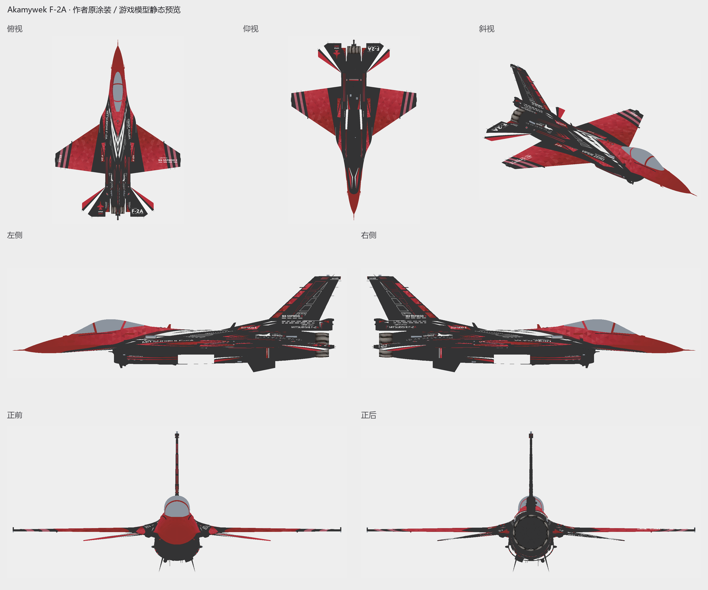

# F-2A · Akamywek 参考原作

<!-- interactive-preview:start -->

**[打开本套涂装的介绍与交互式 3D 预览](https://icyryna.github.io/war-thunder-liveries/works/f2a-akamywek/)**

打开即载入本套模型与涂装，可拖动旋转和切换视角。

<!-- interactive-preview:end -->

**状态：参考原作**

原作者游戏包按原字节保存，作者与来源单独列明。

[查看下载附件](https://github.com/IcyRyna/war-thunder-liveries/releases/tag/references/f2a-akamywek/current)

## 下载

| 文件用途 | 附件 | 大小 |
| --- | --- | --- |
| 参考游戏原包 | [f2a-akamywek-original.zip](https://github.com/IcyRyna/war-thunder-liveries/releases/download/references/f2a-akamywek/current/f2a-akamywek-original.zip) | 5.5 MiB |
| 制作资料／展示附件 | [f2a-akamywek-reference.png](https://github.com/IcyRyna/war-thunder-liveries/releases/download/references/f2a-akamywek/current/f2a-akamywek-reference.png) | 0.8 MiB |

## 安装与工程

游戏包解压后，将含有 `.blk` 和纹理的整个作品文件夹放入对应客户端的 `UserSkins/`。

## 来源与使用

原作者游戏包按原字节保存，作者与来源单独列明。

[当前发布与全部附件](https://github.com/IcyRyna/war-thunder-liveries/releases/tag/references/f2a-akamywek/current) · [下载校验](../../../docs/checksums/f2a-akamywek.sha256) · [安装指南](../../../docs/installation.md) · [返回作品集](../../../README.md)
