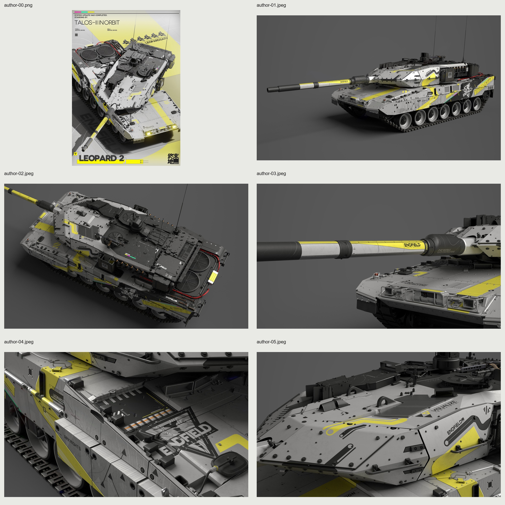

# 豹 2A7V · 终末地参考原作

**状态：参考原作**

原作者游戏包按原字节保存，作者与来源单独列明。

[查看下载附件](https://github.com/IcyRyna/war-thunder-liveries/releases/tag/references/leopard2a7v-endfield/current)

## 下载

| 文件用途 | 附件 | 大小 |
| --- | --- | --- |
| 参考游戏原包 | [leopard2a7v-endfield-original.zip](https://github.com/IcyRyna/war-thunder-liveries/releases/download/references/leopard2a7v-endfield/current/leopard2a7v-endfield-original.zip) | 203.7 MiB |
| 制作资料／展示附件 | [leopard2a7v-endfield-reference.png](https://github.com/IcyRyna/war-thunder-liveries/releases/download/references/leopard2a7v-endfield/current/leopard2a7v-endfield-reference.png) | 3.4 MiB |

## 安装与工程

游戏包解压后，将含有 `.blk` 和纹理的整个作品文件夹放入对应客户端的 `UserSkins/`。

## 来源与使用

原作者游戏包按原字节保存，作者与来源单独列明。

[当前发布与全部附件](https://github.com/IcyRyna/war-thunder-liveries/releases/tag/references/leopard2a7v-endfield/current) · [下载校验](../../../docs/checksums/leopard2a7v-endfield.sha256) · [安装指南](../../../docs/installation.md) · [返回作品集](../../../README.md)
