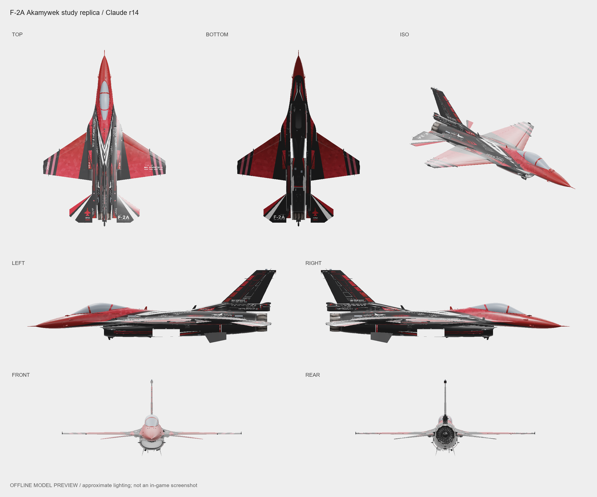

# F-2A · Akamywek 复刻

Claude 对 Akamywek F-2A M4 SOPMOD II 涂装的学习复刻，保存 r14 的现有结果。

版本：[v1](https://github.com/IcyRyna/war-thunder-liveries/releases/tag/works/f2a-akamywek-replica/v1) · 状态：待评价

备份版本 v1，制作修订 r14。颜色图按原作测量重建，材质与挂载贴图沿用原包。源资料含36组设计 JSON、颜色图和离线场景，整套自动重建命令未整理。

展示图为离线模型预览，使用包内贴图与近似受光；尚未完成游戏内验证。

保留的差异包括后段靶标角括号、机头细弧线末端、极小文字、三角内拉丝和红条暗边。

原设计：[Akamywek · F-2A M4 SOPMOD II](https://live.warthunder.com/post/1169410/en/)。

## 下载

| 文件 | 大小 |
| --- | --- |
| [TGA 涂装包（8K）](https://github.com/IcyRyna/war-thunder-liveries/releases/download/works/f2a-akamywek-replica/v1/F2A_Replica_Claude_r14_v1.zip) | 19.1 MB |
| [复刻源资料](https://github.com/IcyRyna/war-thunder-liveries/releases/download/works/f2a-akamywek-replica/v1/F2A_Replica_Claude_r14_Source_v1.zip) | 23.9 MB |
| [七视图](https://github.com/IcyRyna/war-thunder-liveries/releases/download/works/f2a-akamywek-replica/v1/f2a-akamywek-replica_seven_views.png) | 0.6 MB |

[安装说明](../../../docs/installation.md) · [SHA-256 校验](../../../docs/checksums/f2a-akamywek-replica.sha256)

[返回作品目录](../../../README.md)
