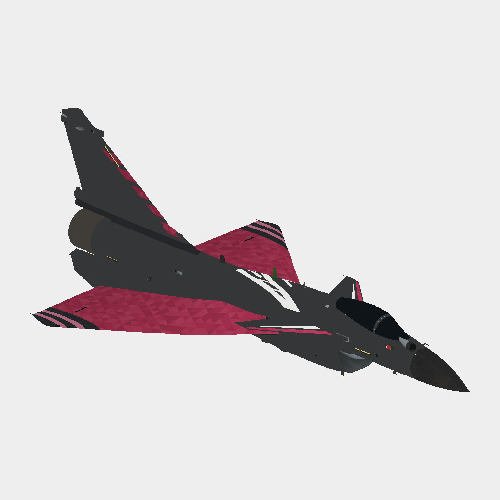

# 歼-10C · 基础布局

早期无人物基础布局，展示主翼色场、翼尖与机背白形。

**已认可** · 2026-11-08

## 下载

- [游戏涂装 ZIP](https://github.com/IcyRyna/war-thunder-liveries/releases/download/works/j10c-base-layout/current/j10c-base-layout-game.zip)
- [离线模型预览](https://github.com/IcyRyna/war-thunder-liveries/releases/download/works/j10c-base-layout/current/j10c-base-layout-preview.jpg)
- [SHA-256 校验](../../../docs/checksums/j10c-base-layout.sha256)

## 安装

将 ZIP 中的 `J-10C_基础布局` 文件夹解压到游戏的 `UserSkins`，进入对应载具的自定义界面，刷新后选择同名涂装。
