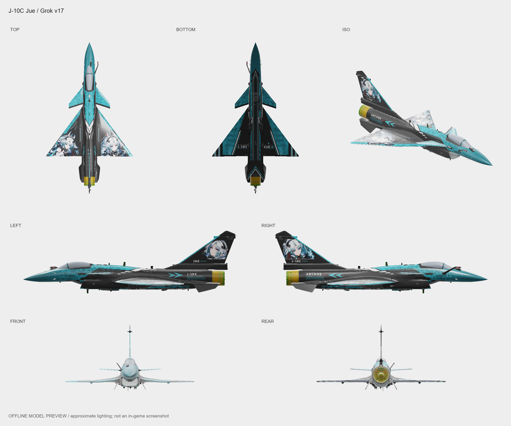

# J-10C 诀 · Grok 版

<!-- interactive-preview:start -->

**[打开本套涂装的介绍与交互式 3D 预览](https://icyryna.github.io/war-thunder-liveries/works/j10c-jue-grok/)**

打开即载入本套模型与涂装，可拖动旋转和切换视角。

<!-- interactive-preview:end -->

**状态：已认可**

Grok 制作的独立方案，与“诀·重修版”分别保存。现有 8K DDS 和 4K TGA 两种游戏包，未找到可编辑制作源。

[下载游戏涂装](https://github.com/IcyRyna/war-thunder-liveries/releases/download/works/j10c-jue-grok/current/j10c-jue-grok-skin.zip) · [下载游戏涂装](https://github.com/IcyRyna/war-thunder-liveries/releases/download/works/j10c-jue-grok/current/j10c-jue-grok-skin-tga-fallback.zip)

## 下载

| 文件用途 | 附件 | 大小 |
| --- | --- | --- |
| 游戏涂装 | [j10c-jue-grok-skin.zip](https://github.com/IcyRyna/war-thunder-liveries/releases/download/works/j10c-jue-grok/current/j10c-jue-grok-skin.zip) | 9.5 MiB |
| 游戏涂装 | [j10c-jue-grok-skin-tga-fallback.zip](https://github.com/IcyRyna/war-thunder-liveries/releases/download/works/j10c-jue-grok/current/j10c-jue-grok-skin-tga-fallback.zip) | 10.6 MiB |
| 七视图 | [j10c-jue-grok-seven-views.png](https://github.com/IcyRyna/war-thunder-liveries/releases/download/works/j10c-jue-grok/current/j10c-jue-grok-seven-views.png) | 0.7 MiB |

## 安装与工程

游戏包解压后，将含有 `.blk` 和纹理的整个作品文件夹放入对应客户端的 `UserSkins/`。

## 来源与使用

素材和原作来源见[来源说明](../../../docs/credits.md)。

[当前发布与全部附件](https://github.com/IcyRyna/war-thunder-liveries/releases/tag/works/j10c-jue-grok/current) · [下载校验](../../../docs/checksums/j10c-jue-grok.sha256) · [安装指南](../../../docs/installation.md) · [返回作品集](../../../README.md)
