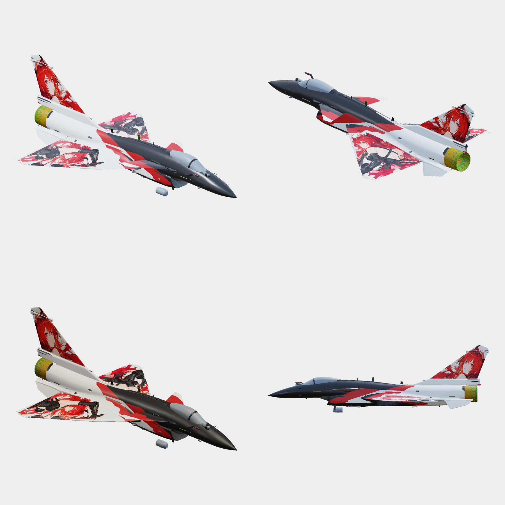

# J-10C 莱万汀 · 黑白红方案

黑白斜分与红色色带的 J-10C 涂装，包含机翼和垂尾的人物布局。

版本：[v8](https://github.com/IcyRyna/war-thunder-liveries/releases/tag/works/j10c-laevatain-akamywek/v8) · 状态：已否定

当前方案已否定，保留为历史方案。v8 改为非金属亮漆；设计源沿用 v7，v8 材质以游戏包为准。人物素材包含参考官方图的生成重绘。

## 下载

| 文件 | 大小 |
| --- | --- |
| [TGA 涂装包](https://github.com/IcyRyna/war-thunder-liveries/releases/download/works/j10c-laevatain-akamywek/v8/J10C_Laevatain_Akamywek_v8.zip) | 30.8 MB |
| [安装说明](https://github.com/IcyRyna/war-thunder-liveries/releases/download/works/j10c-laevatain-akamywek/v8/J10C_Laevatain_v8_install_notes_zh.txt) | 1.3 KB |
| [设计源包（v7）](https://github.com/IcyRyna/war-thunder-liveries/releases/download/works/j10c-laevatain-akamywek/v7/J10C_Laevatain_Akamywek_v7_Editable.zip) | 46.1 MB |

[安装说明](../../../docs/installation.md) · [SHA-256 校验](../../../docs/checksums/j10c-laevatain-akamywek.sha256)

## 版本记录

| 版本 | 改动 | 状态 |
| --- | --- | --- |
| [v8](https://github.com/IcyRyna/war-thunder-liveries/releases/tag/works/j10c-laevatain-akamywek/v8) | 调整为非金属亮漆，颜色图沿用 v7。 | 已否定 |
| [v7](https://github.com/IcyRyna/war-thunder-liveries/releases/tag/works/j10c-laevatain-akamywek/v7) | 黑白斜分与红色色带方案，加入机翼和垂尾人物。人物为参考官方素材的生成重绘；存在弯曲表面拉伸与局部衔接问题。 | 待评价 |
| [v6](https://github.com/IcyRyna/war-thunder-liveries/releases/tag/works/j10c-laevatain-akamywek/v6) | 在基本布局上加入主翼和垂尾人物，移除垂尾文字。素材包含官方图处理和生成补绘。 | 待评价 |
| [v5](https://github.com/IcyRyna/war-thunder-liveries/releases/tag/works/j10c-laevatain-akamywek/v5) | 重做机背白色图形与切缝，加粗垂尾描边。 | 待评价 |
| [v4](https://github.com/IcyRyna/war-thunder-liveries/releases/tag/works/j10c-laevatain-akamywek/v4) | 重做基本布局，调整机背、主翼、鸭翼和垂尾图形。 | 待评价 |
| [v3](https://github.com/IcyRyna/war-thunder-liveries/releases/tag/works/j10c-laevatain-akamywek/v3) | 调整机背、鸭翼和人物布局，加入面板细线。 | 待评价 |
| [v2](https://github.com/IcyRyna/war-thunder-liveries/releases/tag/works/j10c-laevatain-akamywek/v2) | 更新亮漆材质、8192² 颜色图与人物素材。 | 待评价 |
| [v1](https://github.com/IcyRyna/war-thunder-liveries/releases/tag/works/j10c-laevatain-akamywek/v1) | 初版布局；机背细线和漆面尚需修订。 | 待评价 |

[返回作品目录](../../../README.md)
