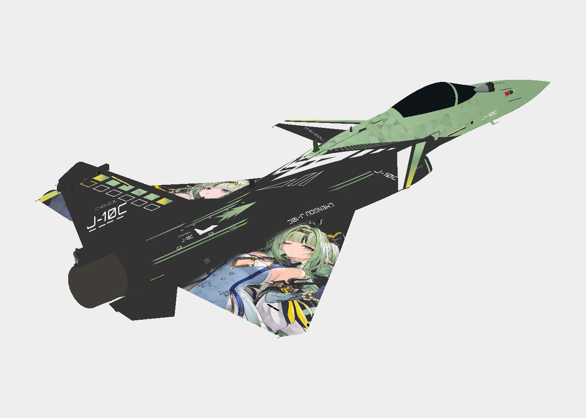

# 歼-10C · 祀

淡翠与金黄围绕双翼清晰人物展开，翼根窄幅过渡，垂尾沿用无人物布局。

**已认可** · 2026-11-08

## 下载

- [游戏涂装 ZIP](https://github.com/IcyRyna/war-thunder-liveries/releases/download/works/j10c-si/current/j10c-si-game.zip)
- [离线模型预览](https://github.com/IcyRyna/war-thunder-liveries/releases/download/works/j10c-si/current/j10c-si-preview.jpg)
- [SHA-256 校验](../../../docs/checksums/j10c-si.sha256)

## 安装

将 ZIP 中的 `J10C_Si` 文件夹解压到游戏的 `UserSkins`，进入对应载具的自定义界面，刷新后选择同名涂装。

青玉金黄无人物版和祀人物版使用同一个包内目录。想要并存时，可在解压时给其中一套涂装文件夹另取名字。

角色题材来自《明日方舟：终末地》。角色与原作素材权利归相应权利人，详见[素材使用范围](../../../docs/licensing.md)。
