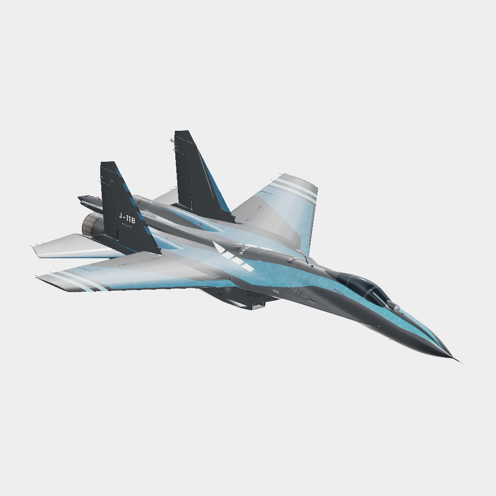

# 歼-11B · 诀基础布局

基础布局修订稿，以实机原生 UV 组织机背白段和侧面色场。

**已认可 · 布局研究** · 2026-11-08

## 下载

- [原尺寸颜色贴图 PNG](https://github.com/IcyRyna/war-thunder-liveries/releases/download/works/j11b-jue-layout/current/j11b-jue-layout-color.png)
- [离线模型预览](https://github.com/IcyRyna/war-thunder-liveries/releases/download/works/j11b-jue-layout/current/j11b-jue-layout-preview.jpg)
- [SHA-256 校验](../../../docs/checksums/j11b-jue-layout.sha256)

本作品以基础布局或局部练习的形式发布，附件可用于查看原生 UV 色图。

角色题材来自《明日方舟：终末地》。角色与原作素材权利归相应权利人，详见[素材使用范围](../../../docs/licensing.md)。
