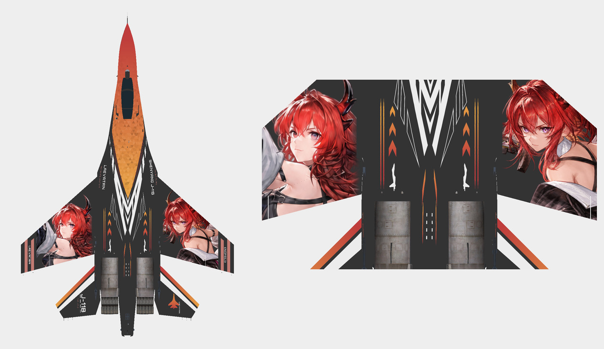

# 歼-11B · 莱万汀 Astra

两幅人物分别占据左右主翼，赤红至橙金的色场呼应炭灰机背与几何垂尾。

**已认可** · 2026-11-08

## 下载

- [游戏涂装 ZIP](https://github.com/IcyRyna/war-thunder-liveries/releases/download/works/j11b-laevatain-astra/current/j11b-laevatain-astra-game.zip)
- [离线模型预览](https://github.com/IcyRyna/war-thunder-liveries/releases/download/works/j11b-laevatain-astra/current/j11b-laevatain-astra-preview.jpg)
- [SHA-256 校验](../../../docs/checksums/j11b-laevatain-astra.sha256)

## 安装

将 ZIP 中的 `J11B_Laevatain_Astra` 文件夹解压到游戏的 `UserSkins`，进入对应载具的自定义界面，刷新后选择同名涂装。

角色题材来自《明日方舟：终末地》。角色与原作素材权利归相应权利人，详见[素材使用范围](../../../docs/licensing.md)。
