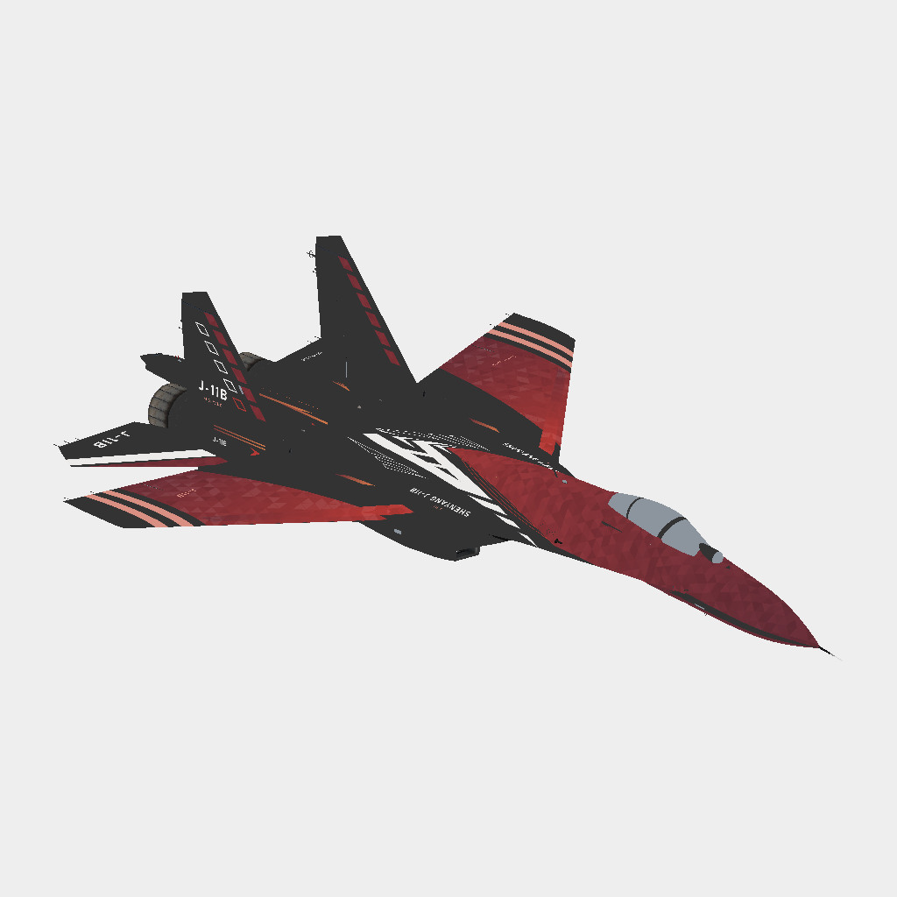

# 歼-11B · 莱万汀基础试画

无人物基础试画，展示红色翼面、翼根楔形与机背中轴。

**已认可 · 布局研究** · 2026-11-08

## 下载

- [原尺寸颜色贴图 PNG](https://github.com/IcyRyna/war-thunder-liveries/releases/download/works/j11b-laevatain-layout/current/j11b-laevatain-layout-color.png)
- [离线模型预览](https://github.com/IcyRyna/war-thunder-liveries/releases/download/works/j11b-laevatain-layout/current/j11b-laevatain-layout-preview.jpg)
- [SHA-256 校验](../../../docs/checksums/j11b-laevatain-layout.sha256)

本作品以基础布局或局部练习的形式发布，附件可用于查看原生 UV 色图。

角色题材来自《明日方舟：终末地》。角色与原作素材权利归相应权利人，详见[素材使用范围](../../../docs/licensing.md)。
