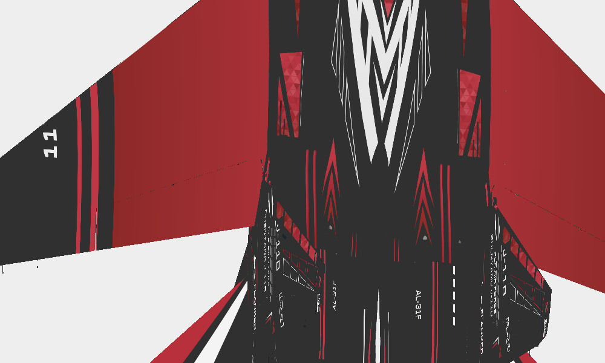

# 歼-11B · 后肩面板练习

以 F-2A 构图为参考的歼-11B 后肩与尾梁布局练习。

**已认可 · 布局研究** · 2026-11-08

## 下载

- [原尺寸颜色贴图 PNG](https://github.com/IcyRyna/war-thunder-liveries/releases/download/works/j11b-shoulder-study/current/j11b-shoulder-study-color.png)
- [离线模型预览](https://github.com/IcyRyna/war-thunder-liveries/releases/download/works/j11b-shoulder-study/current/j11b-shoulder-study-preview.jpg)
- [SHA-256 校验](../../../docs/checksums/j11b-shoulder-study.sha256)

本作品以基础布局或局部练习的形式发布，附件可用于查看原生 UV 色图。
