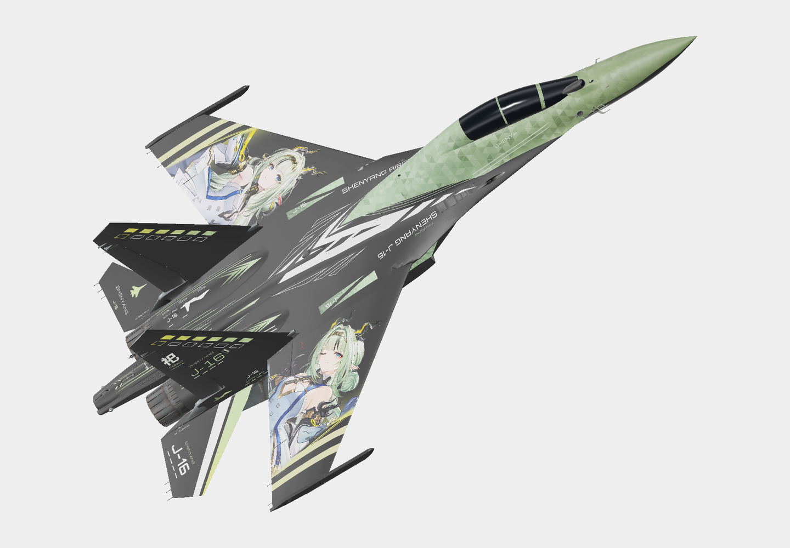

# 歼-16 · 祀

两幅人物跨主翼与活动翼面布置，翠绿和金黄色带沿外翼收尖。

**已认可** · 2026-11-08

## 下载

- [游戏涂装 ZIP](https://github.com/IcyRyna/war-thunder-liveries/releases/download/works/j16-si/current/j16-si-game.zip)
- [离线模型预览](https://github.com/IcyRyna/war-thunder-liveries/releases/download/works/j16-si/current/j16-si-preview.jpg)
- [SHA-256 校验](../../../docs/checksums/j16-si.sha256)

## 安装

将 ZIP 中的 `J16_Si` 文件夹解压到游戏的 `UserSkins`，进入对应载具的自定义界面，刷新后选择同名涂装。

角色题材来自《明日方舟：终末地》。角色与原作素材权利归相应权利人，详见[素材使用范围](../../../docs/licensing.md)。
