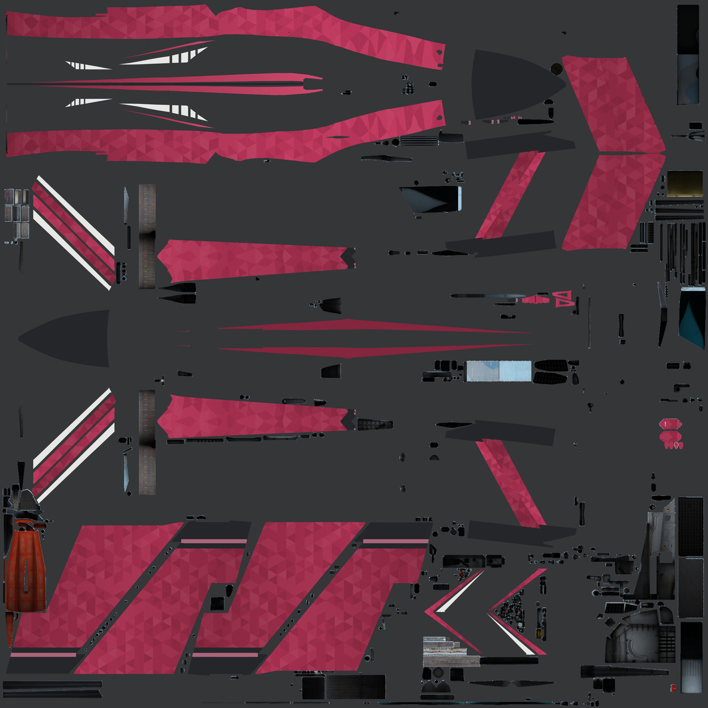

# Su-30SM2 · 基础布局

双发机体的无人物基础布局，预览为游戏包中的原色贴图展开。

**已认可** · 2026-11-08

## 下载

- [游戏涂装 ZIP](https://github.com/IcyRyna/war-thunder-liveries/releases/download/works/su30sm2-base-layout/current/su30sm2-base-layout-game.zip)
- [颜色贴图展开](https://github.com/IcyRyna/war-thunder-liveries/releases/download/works/su30sm2-base-layout/current/su30sm2-base-layout-preview.jpg)
- [SHA-256 校验](../../../docs/checksums/su30sm2-base-layout.sha256)

## 安装

将 ZIP 中的 `Su-30SM2_基础布局` 文件夹解压到游戏的 `UserSkins`，进入对应载具的自定义界面，刷新后选择同名涂装。
