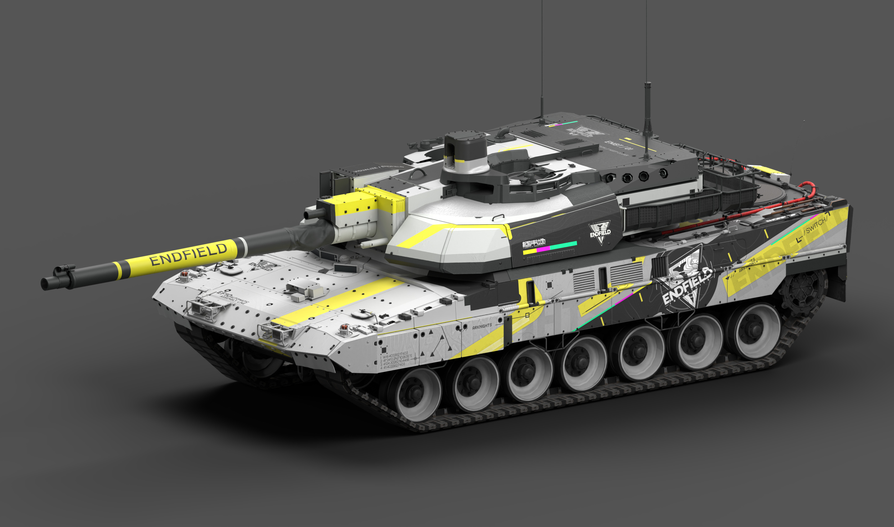
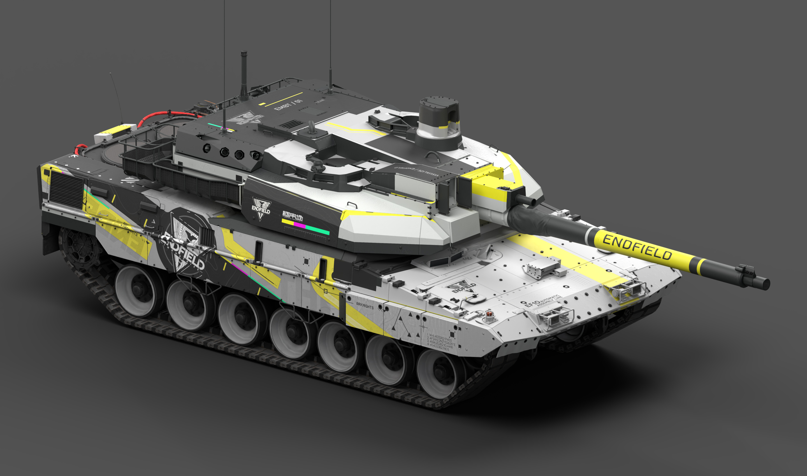
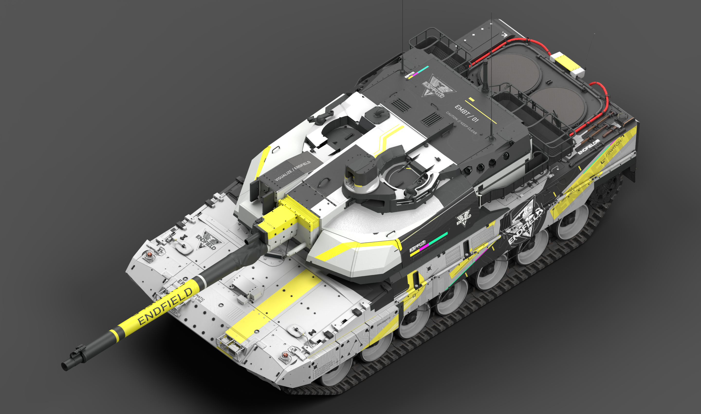

# EMBT（法国）· ENDFIELD

状态：待评价

炮塔侧甲加入完整微标、标尺与工程定位图形。当前局部修订工程与最终 DDS 配对，整套美术待评价；旧重建运行时依赖已退役。

内部标识：`C245C5E9`

原作参考：HK416の午夜福音 · [原帖](https://live.warthunder.com/post/1162771/en/)

## 七视图

## 下载

| 文件 | 内容 | 大小 |
| --- | --- | --- |
| [embt-endfield-skin.zip](https://github.com/IcyRyna/war-thunder-liveries/releases/download/works/embt-endfield/current/embt-endfield-skin.zip) | 游戏涂装 | 251.0 MiB |
| [embt-endfield-source.zip](https://github.com/IcyRyna/war-thunder-liveries/releases/download/works/embt-endfield/current/embt-endfield-source.zip) | 可编辑工程与源码 | 1.0 MiB |
| [embt-endfield-seven-views.png](https://github.com/IcyRyna/war-thunder-liveries/releases/download/works/embt-endfield/current/embt-endfield-seven-views.png) | 展示图 PNG | 7.3 MiB |
| [embt-endfield-hero-front.png](https://github.com/IcyRyna/war-thunder-liveries/releases/download/works/embt-endfield/current/embt-endfield-hero-front.png) | 单视角大图 PNG | 2.0 MiB |
| [embt-endfield-hero-opposite.png](https://github.com/IcyRyna/war-thunder-liveries/releases/download/works/embt-endfield/current/embt-endfield-hero-opposite.png) | 单视角大图 PNG | 2.3 MiB |
| [embt-endfield-hero-overview.png](https://github.com/IcyRyna/war-thunder-liveries/releases/download/works/embt-endfield/current/embt-endfield-hero-overview.png) | 单视角大图 PNG | 2.6 MiB |

游戏包解压后，把整个涂装文件夹放入对应客户端的 `UserSkins/`。源码保留原目录与修订文件名，便于继续编辑；它们不作为公开制作版本标识。

单视角大图是独立 PNG，不包含在游戏 ZIP 中。演示图采用真实模型与当前贴图的离线棚拍渲染。

[当前发布与全部附件](https://github.com/IcyRyna/war-thunder-liveries/releases/tag/works/embt-endfield/current) · [校验值](../../../docs/checksums/embt-endfield.sha256) · [安装说明](../../../docs/installation.md) · [返回目录](../../../README.md)
