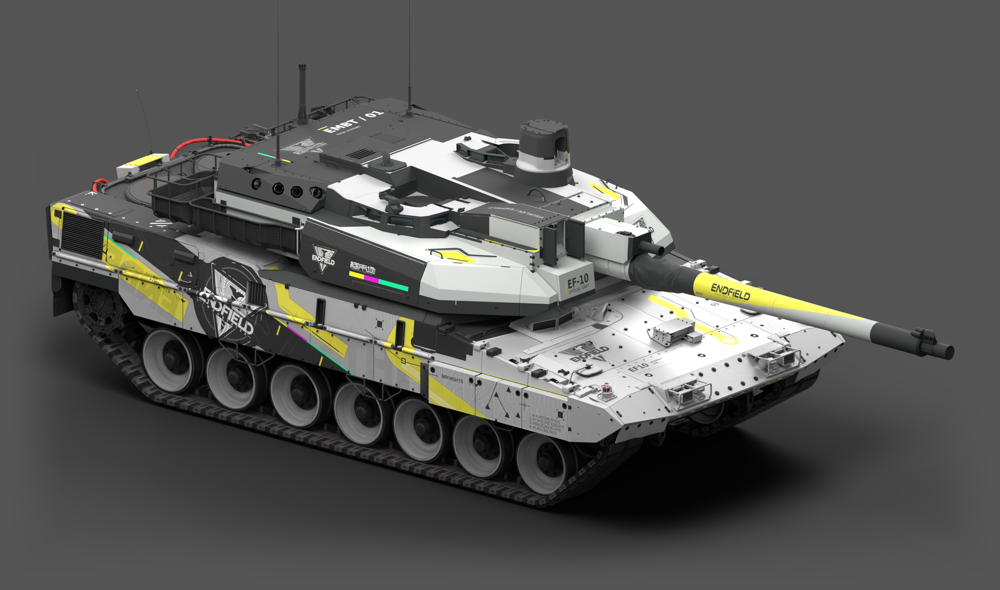
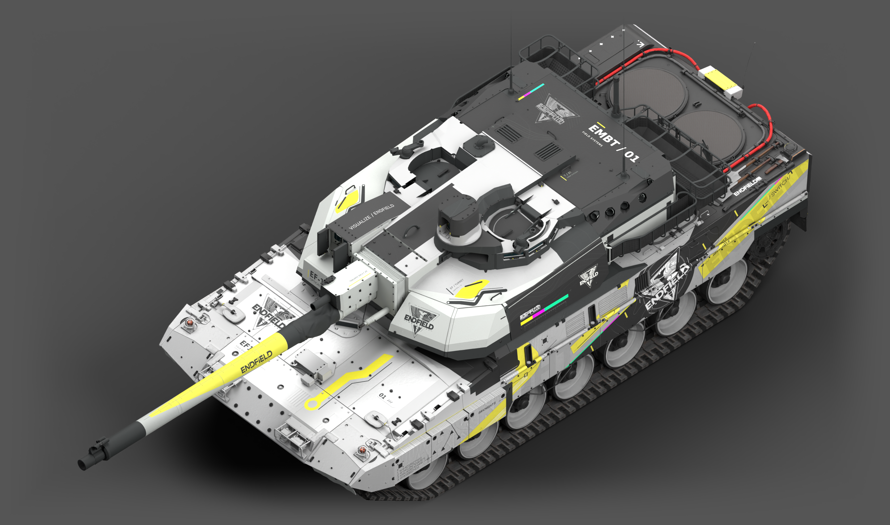
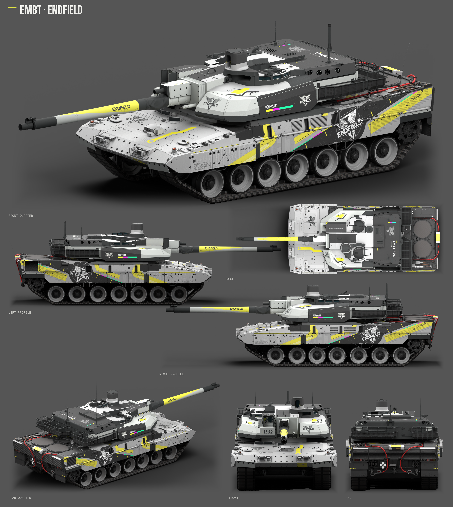

# EMBT（德国／法国）· ENDFIELD

状态：已认可（当前美术方案）

正面两侧彩条已移除；EF-10 铭文放大10%，完整工业徽记放大、左移并按装甲面重新定正。顶部三色条、车体、炮管与镜面材质保留。

适配德国与法国 EMBT，分别使用 `germ_embt.blk`、`fr_embt.blk`。内部标识：`F0334D04`。

## 七视图

## 下载

| 文件 | 内容 | 大小 |
| --- | --- | --- |
| [embt-endfield-skin.zip](https://github.com/IcyRyna/war-thunder-liveries/releases/download/works/embt-endfield/current/embt-endfield-skin.zip) | 德法通用游戏涂装 | 200.1 MiB |
| [embt-endfield-source.zip](https://github.com/IcyRyna/war-thunder-liveries/releases/download/works/embt-endfield/current/embt-endfield-source.zip) | 完整分层工程与源码 | 674.6 MiB |
| [embt-endfield-seven-views.png](https://github.com/IcyRyna/war-thunder-liveries/releases/download/works/embt-endfield/current/embt-endfield-seven-views.png) | 七视图 | 8.0 MiB |
| [embt-endfield-hero-front.png](https://github.com/IcyRyna/war-thunder-liveries/releases/download/works/embt-endfield/current/embt-endfield-hero-front.png) | 斜前整车大图 | 2.2 MiB |
| [embt-endfield-hero-opposite.png](https://github.com/IcyRyna/war-thunder-liveries/releases/download/works/embt-endfield/current/embt-endfield-hero-opposite.png) | 另一侧整车大图 | 2.4 MiB |
| [embt-endfield-hero-overview.png](https://github.com/IcyRyna/war-thunder-liveries/releases/download/works/embt-endfield/current/embt-endfield-hero-overview.png) | 俯瞰整车大图 | 2.8 MiB |

## 安装与继续编辑

将游戏包中的整个 `EMBT_ENDFIELD` 文件夹放入所用客户端的 `UserSkins/`，在德系或法系 EMBT 的自定义涂装列表中选择它。

完整工程包含 52 份分层 CMPS、当前整幅贴图、原生模型素材、参考导出和独立重建工具。保留源码内部原目录与文件名；从工程根目录运行 `python -B -X utf8 design/当前工程/build_skin.py --check` 可核对当前源文件与游戏贴图。编辑裁片的 UV、通道及导出名见 `design/当前工程/editor-index.json`。

当前美术方案已获用户认可；文件绑定、DDS 读回、独立源码检查及 WTG 部署哈希核对通过。游戏内视觉复检未运行。展示图使用真实模型与当前贴图的离线棚拍渲染。

原作参考：HK416の午夜福音 · [原帖](https://live.warthunder.com/post/1162771/en/)

[当前发布与全部附件](https://github.com/IcyRyna/war-thunder-liveries/releases/tag/works/embt-endfield/current) · [固定存档](https://github.com/IcyRyna/war-thunder-liveries/releases/tag/works/embt-endfield/v3) · [校验值](../../../docs/checksums/embt-endfield.sha256) · [返回目录](../../../README.md)
