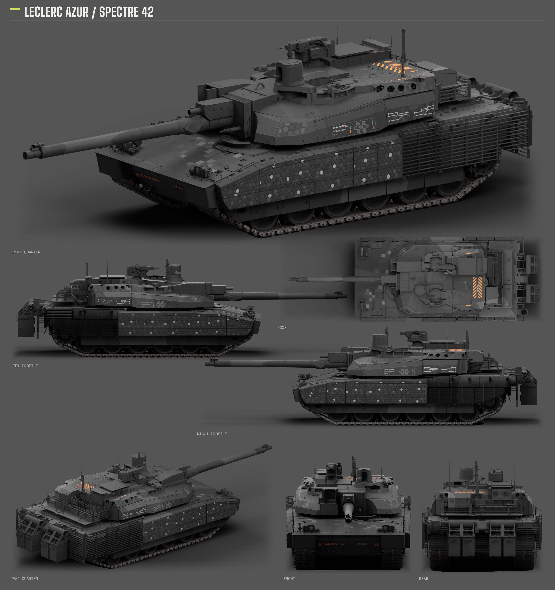
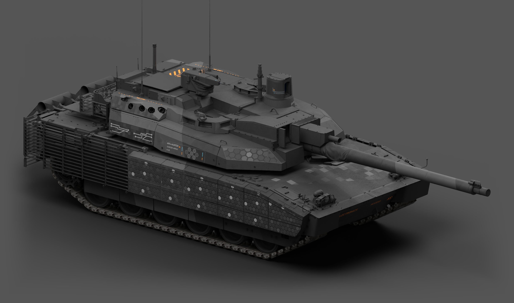
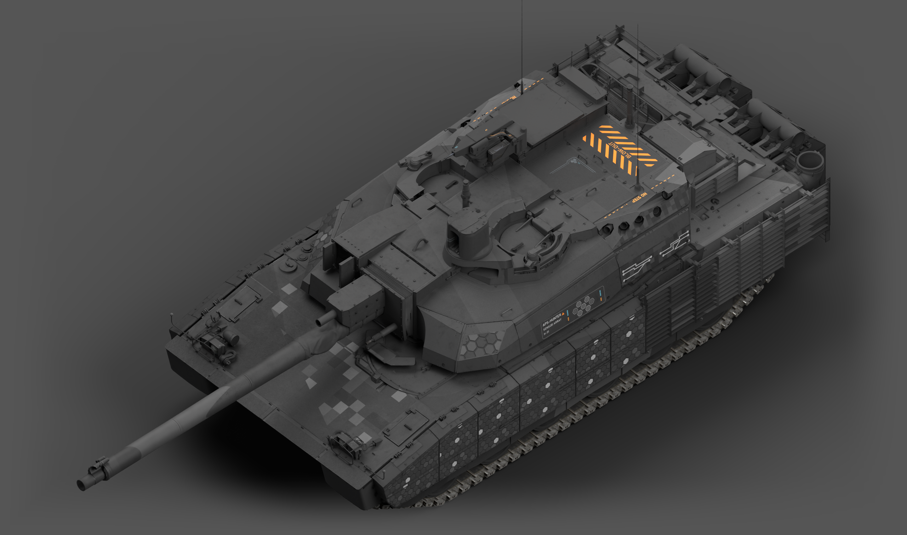

# 勒克莱尔 AZUR · SPECTRE42

炭黑哑光底色、蜂窝装甲模块、仪器线路与克制的黄青色标，按 AZUR 原生表面与 UV 重新组织。遥控武器站外护罩只保留黄青点缀；原车结构、光学窗口与机构分开处理。

**状态：已认可。**

## 下载

- [游戏涂装 ZIP](https://github.com/IcyRyna/war-thunder-liveries/releases/download/works/leclerc-azur-spectre42/v17/leclerc-azur-spectre42-game.zip)
- [预览与透明素材](https://github.com/IcyRyna/war-thunder-liveries/releases/download/works/leclerc-azur-spectre42/v17/leclerc-azur-spectre42-preview.zip)
- 可编辑工程与源码保留原 ZIP 字节，以两个分卷提供：[leclerc-azur-spectre42-source.zip.part01](https://github.com/IcyRyna/war-thunder-liveries/releases/download/works/leclerc-azur-spectre42/v17/leclerc-azur-spectre42-source.zip.part01), [leclerc-azur-spectre42-source.zip.part02](https://github.com/IcyRyna/war-thunder-liveries/releases/download/works/leclerc-azur-spectre42/v17/leclerc-azur-spectre42-source.zip.part02)。
- 下载全部分卷、[校验清单](https://github.com/IcyRyna/war-thunder-liveries/releases/download/works/leclerc-azur-spectre42/v17/source-parts.json)与[合并脚本](https://github.com/IcyRyna/war-thunder-liveries/releases/download/works/leclerc-azur-spectre42/v17/assemble-source.ps1)到同一目录，运行 PowerShell 脚本后得到原源码 ZIP。

游戏包内是 `Leclerc_AZUR_SPECTRE42` 文件夹，解压至客户端 `UserSkins/`，在 AZUR 自定义涂装中刷新选择。源码包括当前五份 CMPS、原生模型与 UV 检查工程、贴图和制作脚本。

## 整车展示

风格参考：[Fying_ 的 SPECTRE42 / WT Live 1192186](https://live.warthunder.com/post/1192186/en/)。当前作品按 AZUR 原生结构重制。参考、游戏资源和自编代码的许可范围见[仓库许可说明](../../../docs/licensing.md)。
