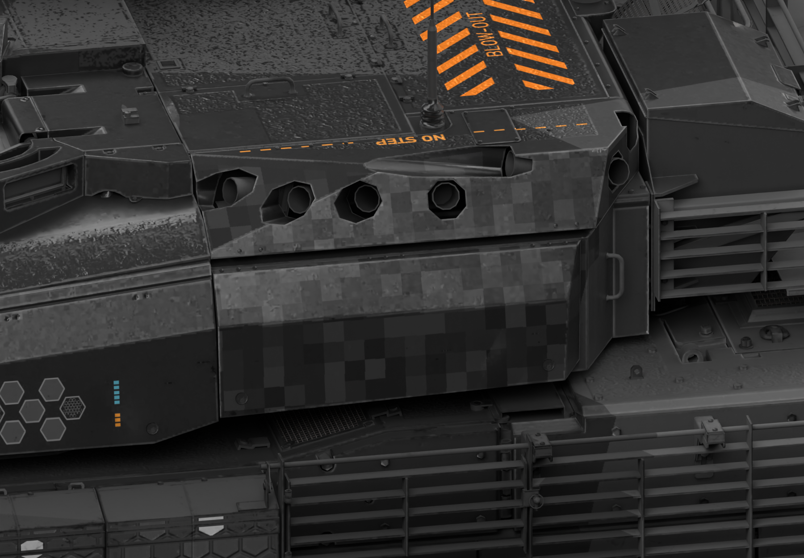
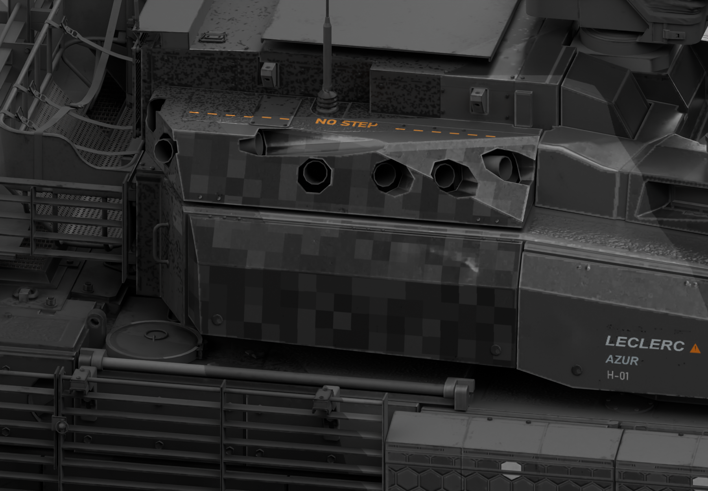

# 勒克莱尔 AZUR · SPECTRE42

深灰与石墨黑的结构迷彩、五档灰色对比块、蜂窝侧装甲、低矮宽体 LECLERC 字标与克制的青橙色标。车体与炮塔保持磨砂金属光泽，黑色火控壳体和光学镜片分别处理。

**状态：修订中。游戏包与独立源码已核验，光学反光仍待游戏视觉确认。**


## 下载

- [游戏涂装 ZIP](https://github.com/IcyRyna/war-thunder-liveries/releases/download/works/leclerc-azur-spectre42/v29/leclerc-azur-spectre42-game.zip)
- [完整可编辑工程与源码 ZIP](https://github.com/IcyRyna/war-thunder-liveries/releases/download/works/leclerc-azur-spectre42/v29/leclerc-azur-spectre42-source.zip)
- [当前七视图与三张独立整车图 ZIP](https://github.com/IcyRyna/war-thunder-liveries/releases/download/works/leclerc-azur-spectre42/v29/leclerc-azur-spectre42-showcase.zip)
- [左右局部细节与整车主图 ZIP](https://github.com/IcyRyna/war-thunder-liveries/releases/download/works/leclerc-azur-spectre42/v29/leclerc-azur-spectre42-preview.zip)

游戏包约 65 MB，解压约 382 MB，只包含配置与纹理。源码独立提供五份 CMPS、完整原生 UV 模型、分层 PNG 与重建脚本，无需合并分卷。

## 七视图


## 另一侧与顶部


## 左右侧细节





## 使用

将游戏包内的 `Leclerc_AZUR_SPECTRE42` 文件夹解压至客户端 `UserSkins/`，刷新选择。覆盖旧文件后，切换其他涂装再切回，让客户端重新读取。

从源码包按需提取 CMPS、模型或 `compact_export.py`。验证时直接读取源码 ZIP，逐张生成临时纹理，避免保留完整解压副本：

```powershell
python -B compact_export.py --source 源码包.zip --verify-only
```

导出时将 `--verify-only` 改为 `--out 新目录`。依赖 Python、Pillow、NumPy、SciPy；全部图层解压后也可使用 `rebuild.py --out 新目录`。

风格参考：[Fying_ 的 SPECTRE42 / WT Live 1192186](https://live.warthunder.com/post/1192186/en/)。当前作品按 AZUR 原生结构重制。参考、游戏资源和自编代码的许可范围见[仓库许可说明](../../../docs/licensing.md)。
