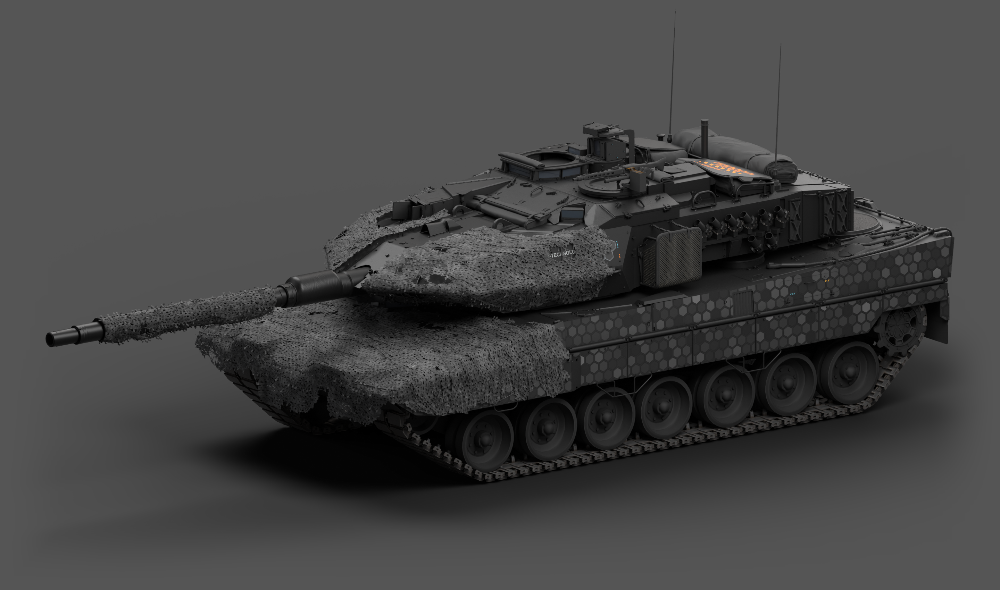
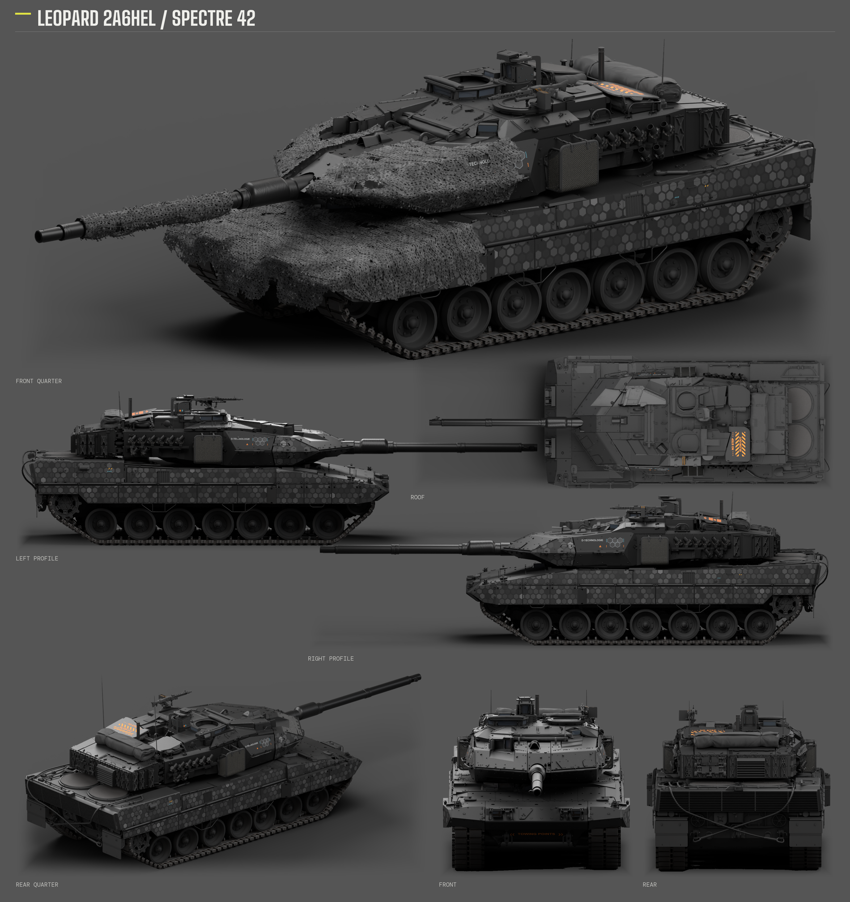
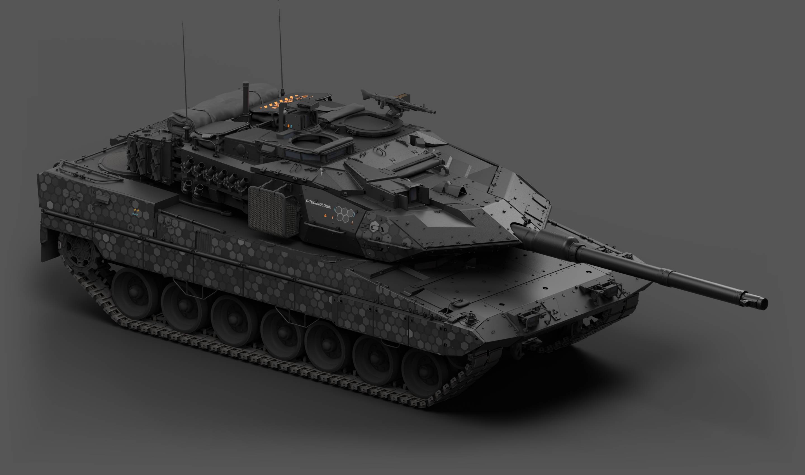
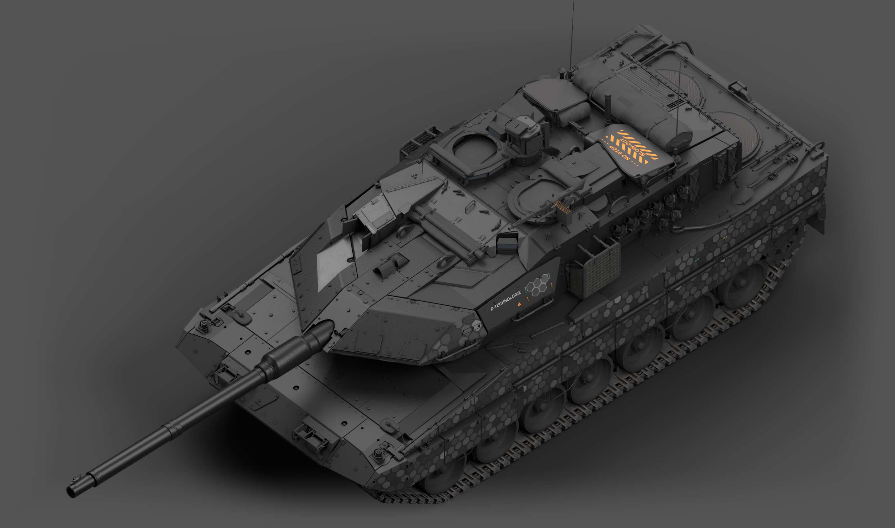

# 豹 2A6HEL · SPECTRE42「炭灰钢装」

炭灰与枪灰金属、侧面蜂窝、首上大面积几何分区，以及克制的青橙识别标记。炮塔与车体使用不同强度的金属反光，火控区压低明度，炮管和炮根与炮塔衔接。

**状态：当前方案已确认可发布。**



## 下载

- [游戏涂装 ZIP](https://github.com/IcyRyna/war-thunder-liveries/releases/download/works/leopard2a6hel-spectre42/v43/leopard2a6hel-spectre42-skin.zip)
- [可编辑工程与源码 ZIP](https://github.com/IcyRyna/war-thunder-liveries/releases/download/works/leopard2a6hel-spectre42/v43/leopard2a6hel-spectre42-source.zip)
- [七视图与三张独立整车图 ZIP](https://github.com/IcyRyna/war-thunder-liveries/releases/download/works/leopard2a6hel-spectre42/v43/leopard2a6hel-spectre42-showcase.zip)

游戏包只包含20份DDS和1份BLK，解压约200 MB。源码含六份分层CMPS、打包贴图的Blender模型、原生UV数据、分层PNG和独立重建脚本，依赖Python、Pillow、NumPy、SciPy和Numba。源码重建已核验15张颜色／材质源图与全部21个游戏文件逐字节一致。

## 七视图



最大斜前主图保留伪装网，其余六个角度去网展示装甲、图形和色区。图片为离线工作室渲染，网布使用静态原生模型与透明裁切，不模拟游戏内随风变形。

## 另一侧与顶部





## 使用与编辑

将游戏包内的 `Leopard2A6HEL_SPECTRE42_Charcoal` 文件夹解压至客户端 `UserSkins/`，刷新后选择对应涂装。

完整解压源码包，在解压根目录运行：

```powershell
python -m pip install -r requirements.txt
python -B rebuild.py --out C:/Temp/A6HEL-SPECTRE42-rebuilt
```

输出目录必须不存在。CMPS与模型位于源码任务目录的 `editor/v43/`；内部施工文件名保留，方便继续编辑和复现。

风格制作参考：[SPECTRE42 / Fying_](https://live.warthunder.com/post/1192186/en/)。涂装按该载具原生结构制作；自编脚本、游戏资源及第三方素材分别适用[仓库许可说明](../../../docs/licensing.md)。
