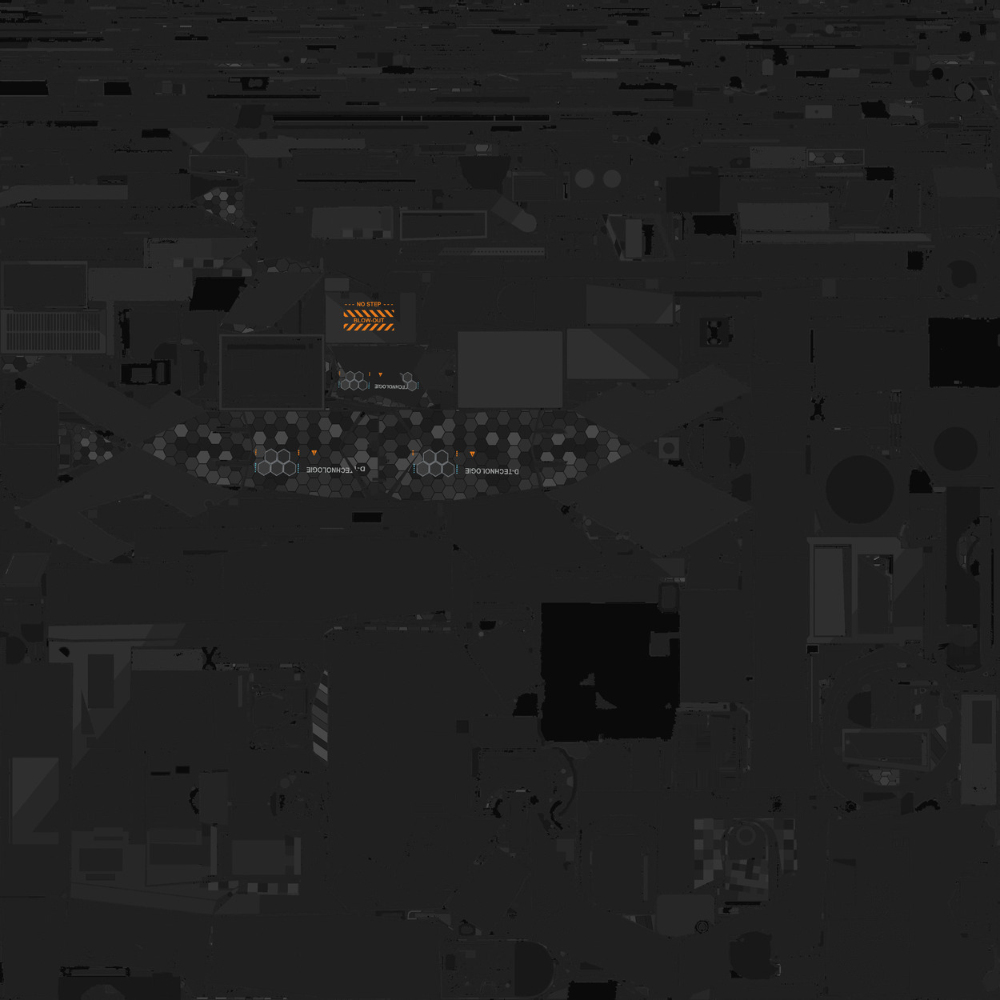

# 豹 2A7HU · 炭灰工业

炮塔和车体以炭灰工业分区组织，预览取自本作炮塔颜色贴图。

**已认可** · 2026-11-08

## 下载

- [游戏涂装 ZIP](https://github.com/IcyRyna/war-thunder-liveries/releases/download/works/leopard2a7hu-charcoal/current/leopard2a7hu-charcoal-game.zip)
- [颜色贴图展开](https://github.com/IcyRyna/war-thunder-liveries/releases/download/works/leopard2a7hu-charcoal/current/leopard2a7hu-charcoal-preview.jpg)
- [SHA-256 校验](../../../docs/checksums/leopard2a7hu-charcoal.sha256)

## 安装

将 ZIP 中的 `Leopard2A7HU_Charcoal_S42` 文件夹解压到游戏的 `UserSkins`，进入对应载具的自定义界面，刷新后选择同名涂装。

本车型的炭灰工业与炭灰数码共用包内目录。同时安装时，可给其中一套涂装文件夹另取名字。
