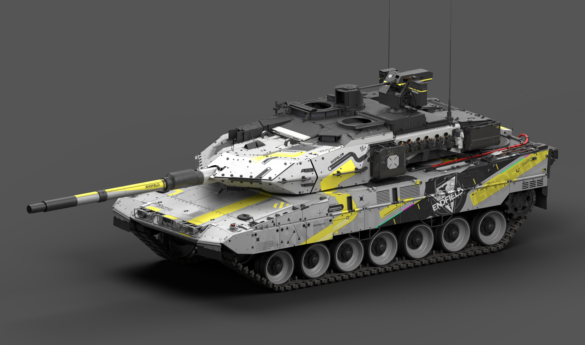
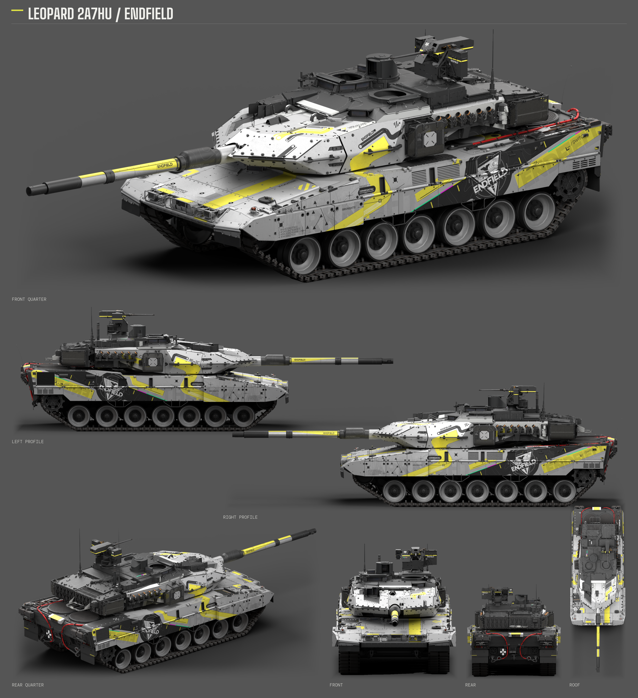
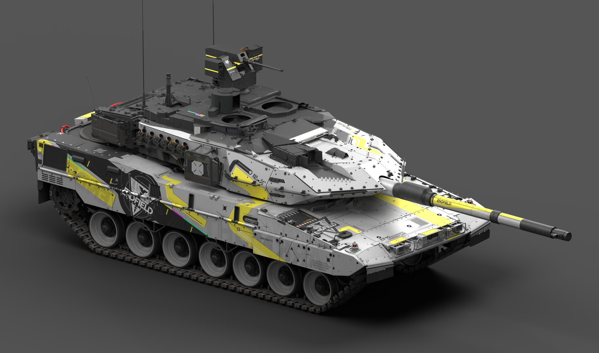
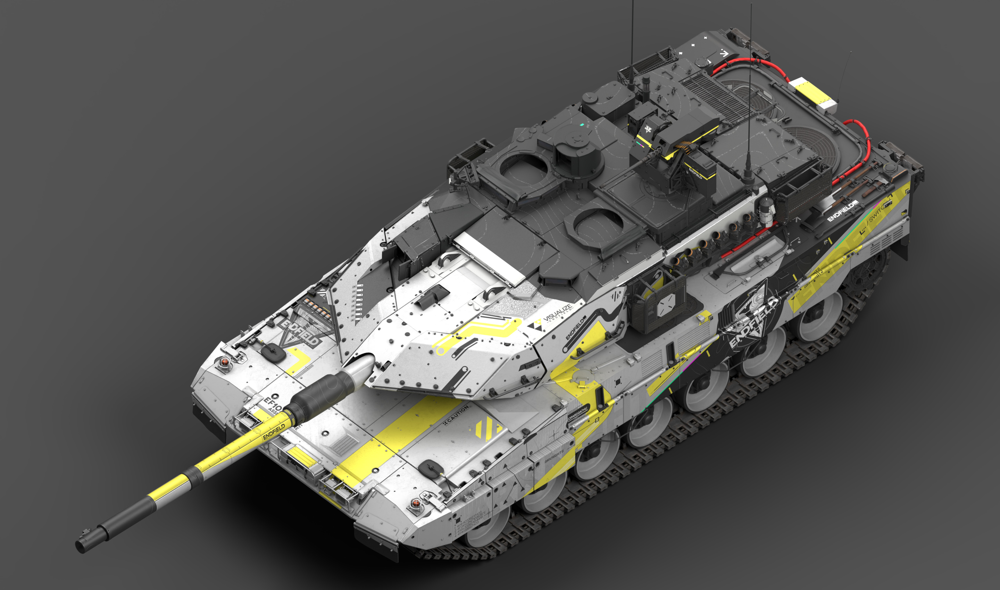

# 豹 2A7HU · 终末地

<!-- interactive-preview:start -->

**[打开本套涂装的介绍与交互式 3D 预览](https://icyryna.github.io/war-thunder-liveries/works/leopard2a7hu-endfield/)**

打开即载入本套模型与涂装，可拖动旋转和切换视角。

<!-- interactive-preview:end -->

**状态：已认可**

当前整套涂装已获用户认可。保留原生 UV 工程、颜色与法线配对及可编辑源码。

[下载游戏涂装](https://github.com/IcyRyna/war-thunder-liveries/releases/download/works/leopard2a7hu-endfield/current/leopard2a7hu-endfield-skin.zip) · [下载可编辑工程](https://github.com/IcyRyna/war-thunder-liveries/releases/download/works/leopard2a7hu-endfield/current/leopard2a7hu-endfield-source.zip)

## 下载

| 文件用途 | 附件 | 大小 |
| --- | --- | --- |
| 游戏涂装 | [leopard2a7hu-endfield-skin.zip](https://github.com/IcyRyna/war-thunder-liveries/releases/download/works/leopard2a7hu-endfield/current/leopard2a7hu-endfield-skin.zip) | 125.1 MiB |
| 可编辑工程与源码 | [leopard2a7hu-endfield-source.zip](https://github.com/IcyRyna/war-thunder-liveries/releases/download/works/leopard2a7hu-endfield/current/leopard2a7hu-endfield-source.zip) | 20.2 MiB |
| 七视图 | [leopard2a7hu-endfield-seven-views.png](https://github.com/IcyRyna/war-thunder-liveries/releases/download/works/leopard2a7hu-endfield/current/leopard2a7hu-endfield-seven-views.png) | 7.5 MiB |
| 整车大图 | [leopard2a7hu-endfield-hero-front.png](https://github.com/IcyRyna/war-thunder-liveries/releases/download/works/leopard2a7hu-endfield/current/leopard2a7hu-endfield-hero-front.png) | 2.0 MiB |
| 整车大图 | [leopard2a7hu-endfield-hero-opposite.png](https://github.com/IcyRyna/war-thunder-liveries/releases/download/works/leopard2a7hu-endfield/current/leopard2a7hu-endfield-hero-opposite.png) | 2.3 MiB |
| 整车大图 | [leopard2a7hu-endfield-hero-overview.png](https://github.com/IcyRyna/war-thunder-liveries/releases/download/works/leopard2a7hu-endfield/current/leopard2a7hu-endfield-hero-overview.png) | 2.7 MiB |

## 七视图

## 更多角度

## 安装与工程

游戏包解压后，将含有 `.blk` 和纹理的整个作品文件夹放入对应客户端的 `UserSkins/`。

继续编辑时下载可编辑源码附件，先读包内说明。保留工程内部目录和原有文件名，按配置准备所需工具。

## 来源与使用

原作参考：HK416の午夜福音 · [原帖](https://live.warthunder.com/post/1162771/en/)

[当前发布与全部附件](https://github.com/IcyRyna/war-thunder-liveries/releases/tag/works/leopard2a7hu-endfield/current) · [下载校验](../../../docs/checksums/leopard2a7hu-endfield.sha256) · [安装指南](../../../docs/installation.md) · [返回作品集](../../../README.md)
