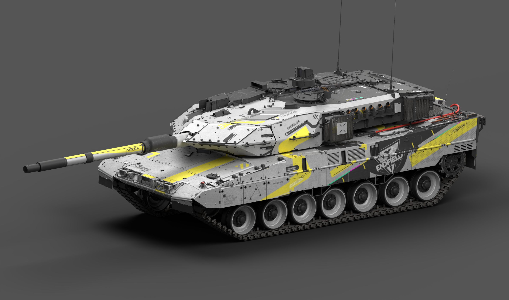
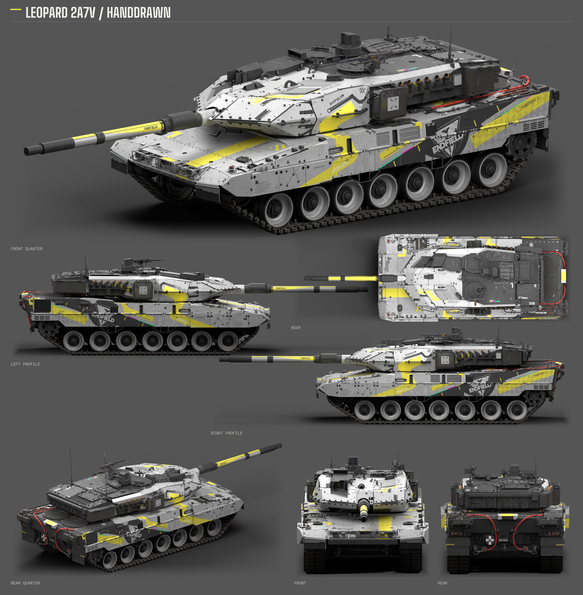
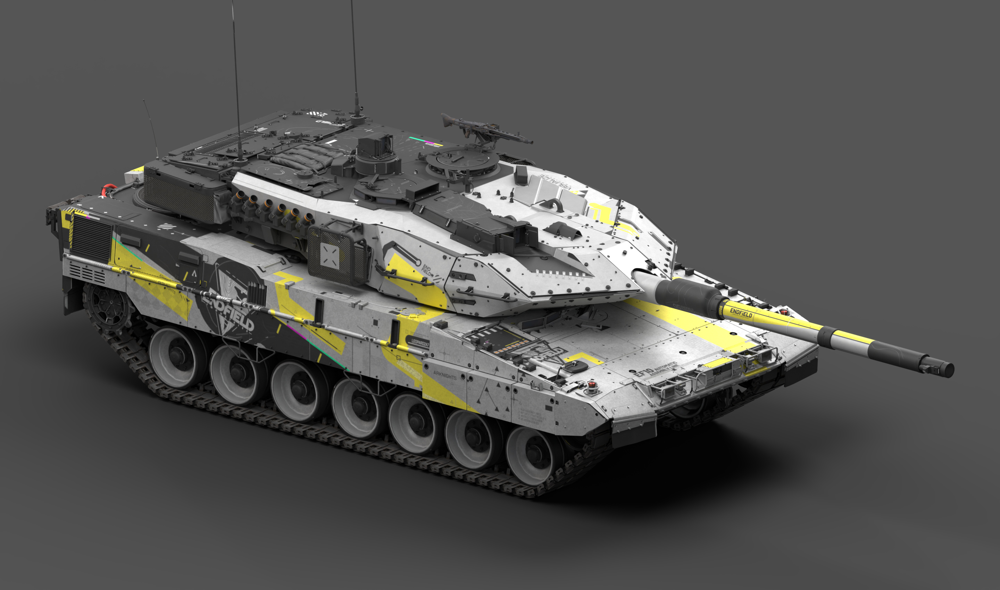
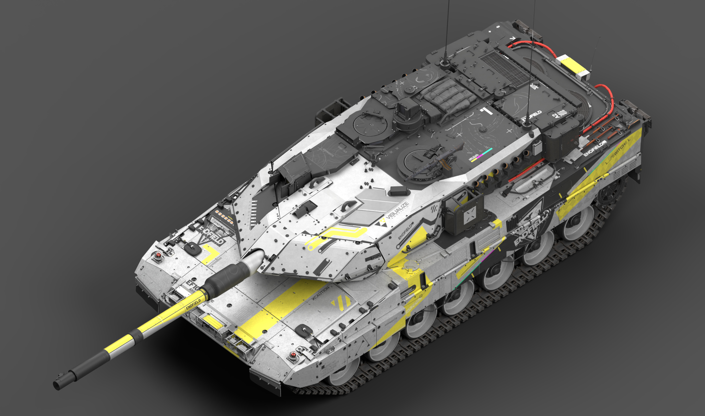

# 豹 2A7V · 终末地手绘临摹

<!-- interactive-preview:start -->

**[打开本套涂装的介绍与交互式 3D 预览](https://icyryna.github.io/war-thunder-liveries/works/leopard2a7v-endfield-handdrawn/)**

打开即载入本套模型与涂装，可拖动旋转和切换视角。

<!-- interactive-preview:end -->

**状态：待评价**

原始手绘临摹结果。现存包提供游戏文件与制作总结，没有原生可编辑图层工程。

[下载游戏涂装](https://github.com/IcyRyna/war-thunder-liveries/releases/download/works/leopard2a7v-endfield-handdrawn/current/leopard2a7v-endfield-handdrawn-skin.zip)

## 下载

| 文件用途 | 附件 | 大小 |
| --- | --- | --- |
| 游戏涂装 | [leopard2a7v-endfield-handdrawn-skin.zip](https://github.com/IcyRyna/war-thunder-liveries/releases/download/works/leopard2a7v-endfield-handdrawn/current/leopard2a7v-endfield-handdrawn-skin.zip) | 150.6 MiB |
| 七视图 | [leopard2a7v-endfield-handdrawn-seven-views.png](https://github.com/IcyRyna/war-thunder-liveries/releases/download/works/leopard2a7v-endfield-handdrawn/current/leopard2a7v-endfield-handdrawn-seven-views.png) | 7.5 MiB |
| 整车大图 | [leopard2a7v-endfield-handdrawn-hero-front.png](https://github.com/IcyRyna/war-thunder-liveries/releases/download/works/leopard2a7v-endfield-handdrawn/current/leopard2a7v-endfield-handdrawn-hero-front.png) | 2.0 MiB |
| 整车大图 | [leopard2a7v-endfield-handdrawn-hero-opposite.png](https://github.com/IcyRyna/war-thunder-liveries/releases/download/works/leopard2a7v-endfield-handdrawn/current/leopard2a7v-endfield-handdrawn-hero-opposite.png) | 2.3 MiB |
| 整车大图 | [leopard2a7v-endfield-handdrawn-hero-overview.png](https://github.com/IcyRyna/war-thunder-liveries/releases/download/works/leopard2a7v-endfield-handdrawn/current/leopard2a7v-endfield-handdrawn-hero-overview.png) | 2.9 MiB |
| 制作资料／展示附件 | [leopard2a7v-endfield-handdrawn-production-notes.zip](https://github.com/IcyRyna/war-thunder-liveries/releases/download/works/leopard2a7v-endfield-handdrawn/current/leopard2a7v-endfield-handdrawn-production-notes.zip) | 0.3 MiB |

## 七视图

## 更多角度

## 安装与工程

游戏包解压后，将含有 `.blk` 和纹理的整个作品文件夹放入对应客户端的 `UserSkins/`。

## 来源与使用

原作参考：HK416の午夜福音 · [原帖](https://live.warthunder.com/post/1162771/en/)

[当前发布与全部附件](https://github.com/IcyRyna/war-thunder-liveries/releases/tag/works/leopard2a7v-endfield-handdrawn/current) · [下载校验](../../../docs/checksums/leopard2a7v-endfield-handdrawn.sha256) · [安装指南](../../../docs/installation.md) · [返回作品集](../../../README.md)
