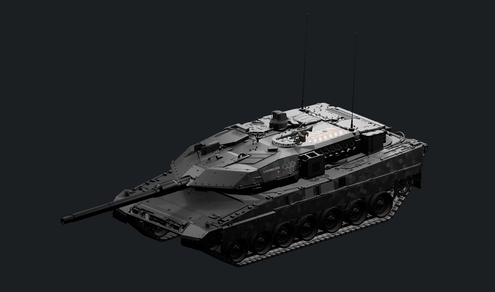
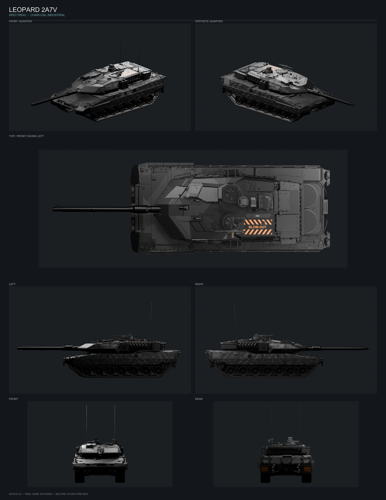
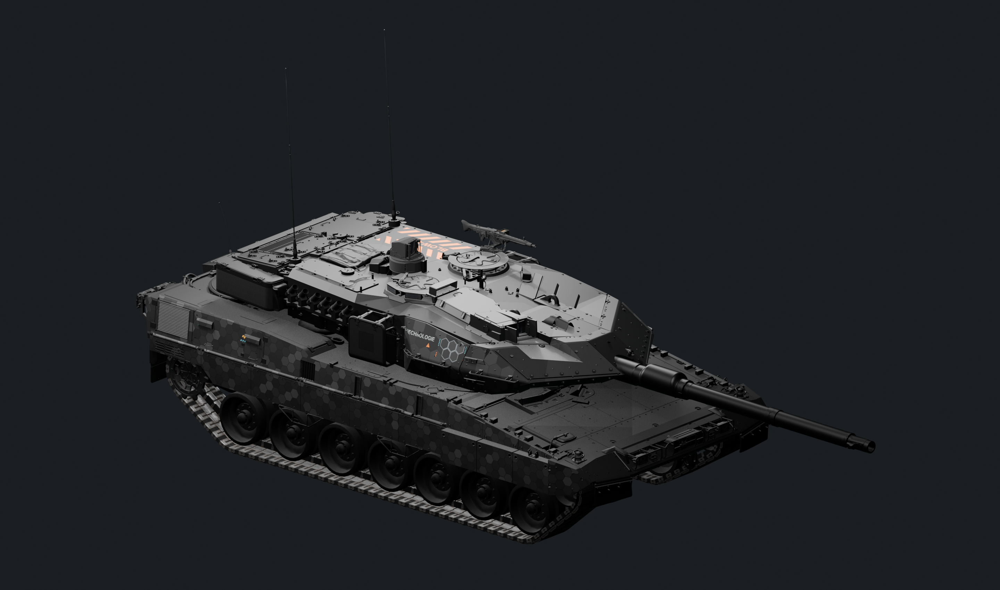
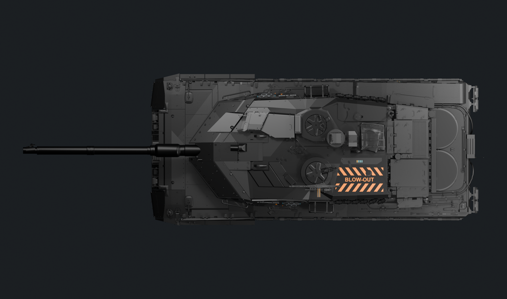

# 豹 2A7V · SPECTRE42「炭灰分区」

<!-- interactive-preview:start -->

**[打开作品介绍与交互式 3D 预览](https://icyryna.github.io/war-thunder-liveries/works/leopard2a7v-spectre42/)**

可拖动旋转模型，检查炭灰几何、蜂窝、顶面警示与分区材质。

<!-- interactive-preview:end -->

这套豹2A7V涂装由豹2A6HEL的SPECTRE42炭灰工业设计适配而来。相近灰阶的大几何分区构成主体，侧裙与炮塔的蜂窝形成疏密层次，D-TECHNOLOGIE组合标识、黄青色标和橙黑警示点缀其间。车体、炮塔、炮管、观瞄壳体和机枪座分别适配材质，保留结构缝、螺栓与细表面纹理。

顶部弹药舱沿长轴布置BLOW-OUT橙色条纹警示，右侧增加低对比灰色分区和一黄三青刻度。车尾两侧保留橙黑警示，与顶部呼应。

**状态：已获准发布。** 游戏文件已与实际部署目录逐文件核对；Composa分层保存、重开、规范导出，DDS全部mip读回及原生UV保护均已验证。七视图和整车大图使用最终游戏DDS绑定真实A7V模型渲染。图片与交互预览为离线PBR近似，材质表现以实际游戏光照为准。



## 下载

- [游戏涂装 ZIP](https://github.com/IcyRyna/war-thunder-liveries/releases/download/works/leopard2a7v-spectre42/current/leopard2a7v-spectre42-skin.zip)
- [可编辑工程与源码 ZIP](https://github.com/IcyRyna/war-thunder-liveries/releases/download/works/leopard2a7v-spectre42/current/leopard2a7v-spectre42-source.zip)
- [七视图与独立大图 ZIP](https://github.com/IcyRyna/war-thunder-liveries/releases/download/works/leopard2a7v-spectre42/current/leopard2a7v-spectre42-showcase.zip)
- [七视图原尺寸 PNG](https://github.com/IcyRyna/war-thunder-liveries/releases/download/works/leopard2a7v-spectre42/current/leopard2a7v-spectre42-seven-views.png)
- [斜前整车大图 PNG](https://github.com/IcyRyna/war-thunder-liveries/releases/download/works/leopard2a7v-spectre42/current/leopard2a7v-spectre42-hero-front.png)
- [另一侧整车大图 PNG](https://github.com/IcyRyna/war-thunder-liveries/releases/download/works/leopard2a7v-spectre42/current/leopard2a7v-spectre42-hero-opposite.png)
- [顶部整车大图 PNG](https://github.com/IcyRyna/war-thunder-liveries/releases/download/works/leopard2a7v-spectre42/current/leopard2a7v-spectre42-hero-overview.png)

游戏包仅包含14张DDS和一份BLK。源码包含七份Composa工程、独立图层、规范颜色与材质数据、原生模型与UV、打包纹理的Blender模型工程、展示场景及重建脚本。展示包含一张3600×4660七视图板和七张2880×1700独立视图，其中三张为整车主展示图。

## 七视图



## 另一侧与顶部





## 安装与更新

1. 解压游戏ZIP，将整个`Leopard2A7V_SPECTRE42_Charcoal`文件夹放进客户端的`UserSkins/`。
2. 在豹2A7V的自定义涂装列表中刷新，选择该文件夹。
3. 更新时覆盖同名目录，然后刷新或重新选择。

这是普通UserSkins涂装，使用原生UV，无需配套模型替换。GitHub自动生成的Source code为仓库快照，继续分层编辑请下载上面的源码附件。

## 继续编辑

源码根目录的`Composa/`保留车体、炮塔、炮管颜色工程及四份材质工程，`layers/`保留独立图层。`Leopard2A7V_Charcoal_ModelUV.blend`是模型与原生UV工程，`Leopard2A7V_Charcoal_Showcase.blend`是本次展示场景。安装`requirements.txt`后精确重建：

```powershell
python -B rebuild.py --out <不存在的新输出目录>
```

材质数据Alpha独立保存；修改材质RGB后按源码说明使用`reassemble_materials.py`组回，不把N.A当图层透明度。完整制作与回退备份另在Release附件`leopard2a7v-spectre42-production-backup.zip`中保留，供需要恢复历史工程时使用。

## 来源与许可

直接适配范本为本仓库[豹2A6HEL的SPECTRE42「炭灰钢装」](../leopard2a6hel-spectre42/README.md)。炭灰工业设计参考[Fying_的SPECTRE42（WT Live 1192186）](https://live.warthunder.com/post/1192186/en/)，制作方法沿用[勒克莱尔AZUR的SPECTRE42工程](../leclerc-azur-spectre42/README.md)，按A7V原生承载面重新适配蜂窝、标识、顶面警示和材质。

游戏模型、UV、原始游戏资源和参考素材归各自权利人；公开下载不为来源素材增加授权。自编脚本和文档、涂装纹理与参考素材分别适用[仓库许可说明](../../../docs/licensing.md)。
