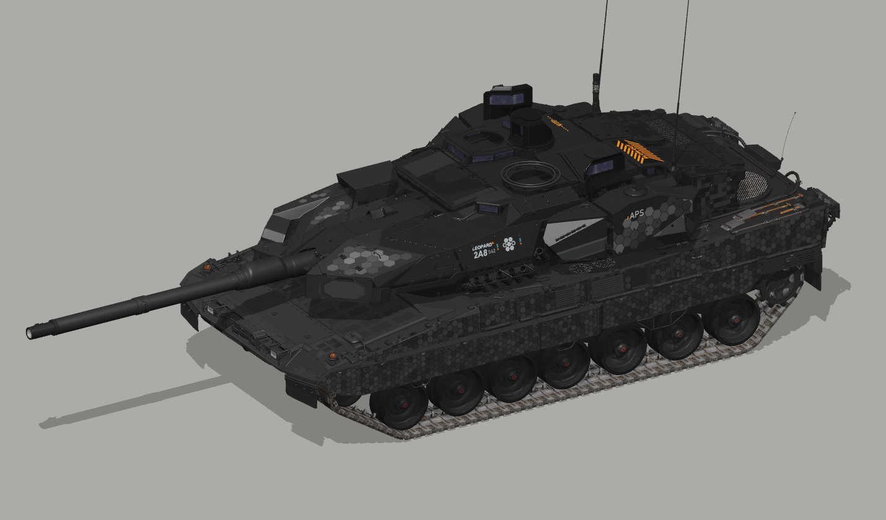

# 豹 2A8 · 炭灰工业

德国车型。深炭灰蜂窝沿侧甲和百叶之间的实板展开，炮塔与车体采用不同的金属质感。

**已认可** · 2026-11-08

## 下载

- [游戏涂装 ZIP](https://github.com/IcyRyna/war-thunder-liveries/releases/download/works/leopard2a8-charcoal/current/leopard2a8-charcoal-game.zip)
- [离线模型预览](https://github.com/IcyRyna/war-thunder-liveries/releases/download/works/leopard2a8-charcoal/current/leopard2a8-charcoal-preview.jpg)
- [SHA-256 校验](../../../docs/checksums/leopard2a8-charcoal.sha256)

## 安装

将 ZIP 中的 `Leopard2A8_Charcoal_S42` 文件夹解压到游戏的 `UserSkins`，进入对应载具的自定义界面，刷新后选择同名涂装。
