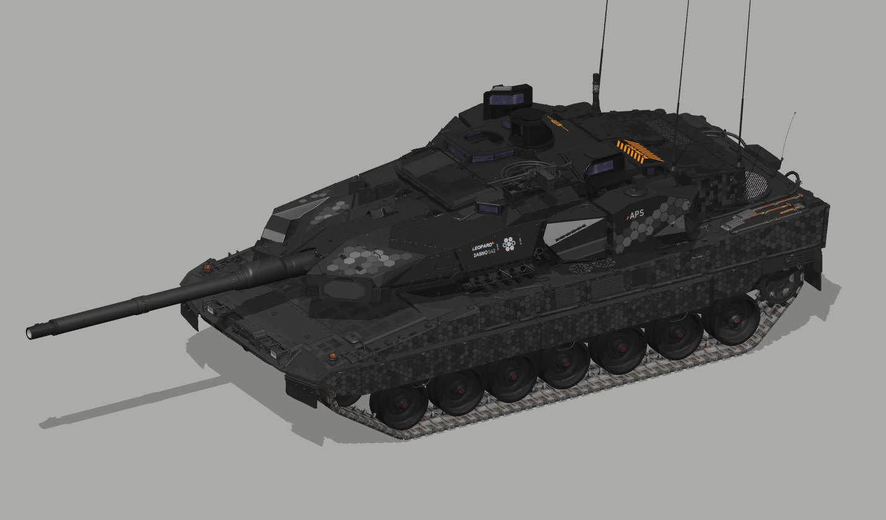

# 豹 2A8NO · 炭灰工业

挪威车型。按本车附件和两侧装甲布置深灰蜂窝，保留百叶开口与雷达表面。

**已认可** · 2026-11-08

## 下载

- [游戏涂装 ZIP](https://github.com/IcyRyna/war-thunder-liveries/releases/download/works/leopard2a8no-charcoal/current/leopard2a8no-charcoal-game.zip)
- [离线模型预览](https://github.com/IcyRyna/war-thunder-liveries/releases/download/works/leopard2a8no-charcoal/current/leopard2a8no-charcoal-preview.jpg)
- [SHA-256 校验](../../../docs/checksums/leopard2a8no-charcoal.sha256)

## 安装

将 ZIP 中的 `Leopard2A8NO_Charcoal_S42` 文件夹解压到游戏的 `UserSkins`，进入对应载具的自定义界面，刷新后选择同名涂装。
