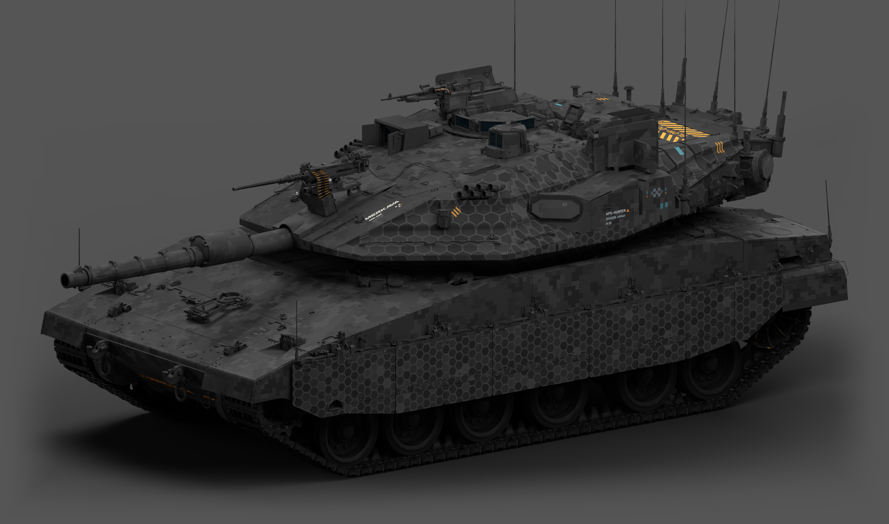
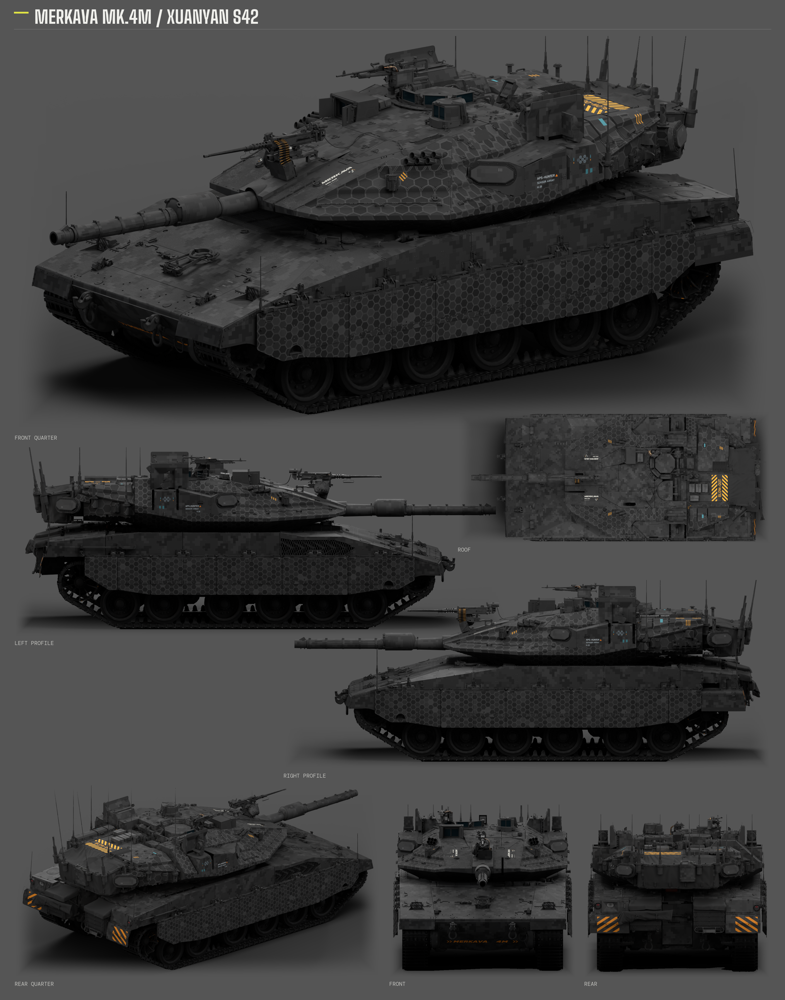
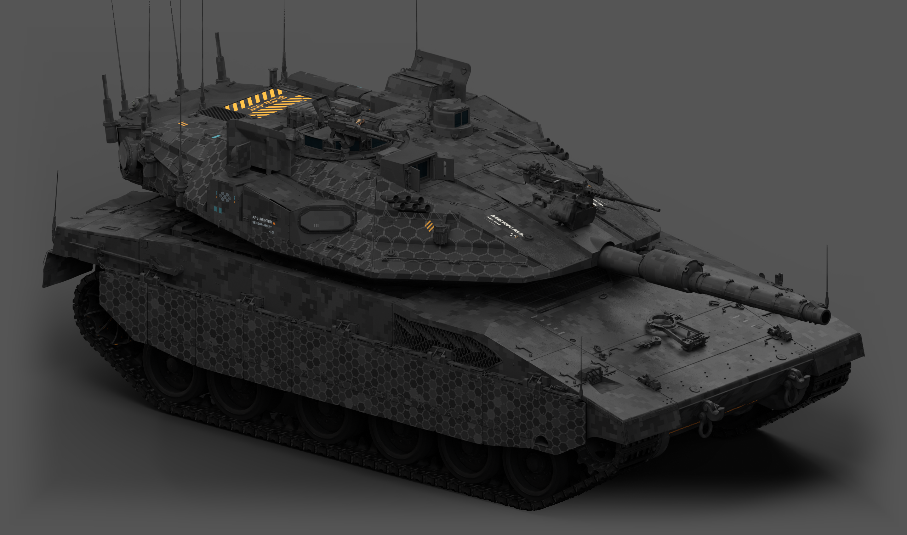
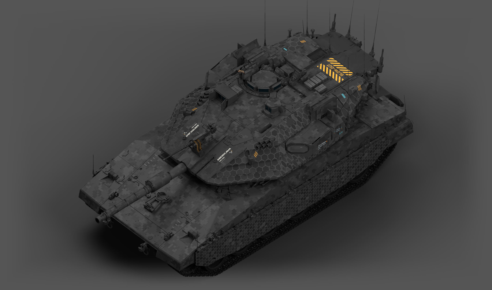

# 梅卡瓦 Mk.4M「玄岩」· S42 / Merkava Mk.4M “Xuanyan” · S42

梅卡瓦 Mk.4M「玄岩」以深炭灰与低对比数码灰块构成主体。侧裙和炮塔侧面以不同尺度的蜂窝呼应，车体与炮塔保留装甲分缝、机械细节和车型字标；青色、琥珀色小刻度与后部橙黑警示提供克制的点缀。车长与炮长观瞄、镜片及附件分别保留各自的材质层次。

Merkava Mk.4M “Xuanyan” uses deep charcoal and low-contrast digital blocks as its base. Honeycomb patterns at different scales connect the side skirts and turret, while the armor seams, mechanical details and vehicle markings remain visible. Small cyan and amber accents and orange-black rear warnings complete the design. The optics, glass and equipment retain distinct material roles.

**状态：已获准发布，最近一次盒体与车体金属度调整的游戏内观感待复核。** 游戏包的 28 个运行文件已与 WTG 部署目录逐文件校验；Composa 分层工程和最终 DDS 的 Blender 模型绑定已核对。展示图为离线棚拍，使用柔和灯光与漫射辅助以展示现有数码，效果不等同游戏截图。

**Status: publication authorized; the latest housing and hull-metal adjustments still await an in-game visual check.** All 28 runtime files were checked against the WTG deployment. The Composa projects and Blender bindings to the delivered DDS were verified. The images are offline studio renders using softened lights and a diffuse display aid to show the existing digital pattern; they are not in-game screenshots.

## 下载 / Downloads

- [游戏涂装与配套 WTG 模型 ZIP / Game skin and matching WTG model](https://github.com/IcyRyna/war-thunder-liveries/releases/download/works/merkava4m-xuanyan-s42/current/merkava4m-xuanyan-s42-game.zip)
- [公开可编辑工程与源码 ZIP / Privacy-clean editable project and source](https://github.com/IcyRyna/war-thunder-liveries/releases/download/works/merkava4m-xuanyan-s42/current/merkava4m-xuanyan-s42-source.zip)
- [七视图与三张整车大图 ZIP / Seven-view board and three large images](https://github.com/IcyRyna/war-thunder-liveries/releases/download/works/merkava4m-xuanyan-s42/current/merkava4m-xuanyan-s42-showcase.zip)
- [七视图 PNG / Seven-view board](https://github.com/IcyRyna/war-thunder-liveries/releases/download/works/merkava4m-xuanyan-s42/current/merkava4m-xuanyan-s42-seven-views.png)
- [斜前整车 / Front-quarter](https://github.com/IcyRyna/war-thunder-liveries/releases/download/works/merkava4m-xuanyan-s42/current/merkava4m-xuanyan-s42-hero-front.png) · [另一侧 / Opposite side](https://github.com/IcyRyna/war-thunder-liveries/releases/download/works/merkava4m-xuanyan-s42/current/merkava4m-xuanyan-s42-hero-opposite.png) · [顶部 / Overhead](https://github.com/IcyRyna/war-thunder-liveries/releases/download/works/merkava4m-xuanyan-s42/current/merkava4m-xuanyan-s42-hero-overview.png)

游戏 ZIP 只含运行所需配置、纹理和匹配模型；展示图单独提供。公开源码包包含 24 个 Composa 工程、PNG、打包 Blender 模型、工作图层、遮罩与原生 UV；本机路径和历史调试回执已移除。

The game ZIP contains only the runtime configuration, textures and matching model; showcase images are separate. The public source ZIP contains 24 Composa projects, PNGs, a packed Blender model, working layers, masks and native UV data. Local paths and historical debug receipts have been removed.

## 七视图 / Seven views

## 另一侧与顶部 / Opposite side and overhead

## 安装与更新 / Installation and updates

1. 下载游戏 ZIP，备份 WTG 隔离客户端中原有的 `content/base/res/tanks/il_merkava_mk_4_baz.grp`。
2. 将 ZIP 内的 `UserSkins/` 与 `content/` 按原目录结构合入对应 WTG 隔离客户端根目录，保持模型与纹理配套。
3. 在梅卡瓦 Mk.4M 的自定义涂装中刷新并选择 `Merkava_4M_Xuanyan_S42`。更新时覆盖同名文件并重新加载；恢复原模型时一并还原备份。

1. Download the game ZIP and back up the isolated WTG client’s `content/base/res/tanks/il_merkava_mk_4_baz.grp`.
2. Merge both `UserSkins/` and `content/` from the ZIP into that WTG client root, preserving their paths and keeping the model and textures together.
3. Refresh the Merkava Mk.4M skin list and select `Merkava_4M_Xuanyan_S42`. For updates, replace the matching files and reload; restore the model backup when reverting.

本作品使用经过适配的原生模型与扩展 UV，不是只复制 `UserSkins/` 即可通用的普通客户端包。 / This is a matched WTG model-and-texture package, not a standard UserSkins-only installation.

## 来源与使用范围 / Sources and rights

炭灰工业风格参考 [Fying_ 的 SPECTRE42 / WT Live 1192186](https://live.warthunder.com/post/1192186/en/)，以仓库的[勒克莱尔 AZUR 工程](../leclerc-azur-spectre42/README.md)为方法参考，并按梅卡瓦 Mk.4M 的模型和 UV 重新布局。游戏资源、涂装纹理和参考素材的权利分别属于各自权利人；代码与文档的 MIT 许可不自动扩展到这些素材。

The industrial style references [Fying_’s SPECTRE42 / WT Live 1192186](https://live.warthunder.com/post/1192186/en/) and the repository’s [Leclerc AZUR project](../leclerc-azur-spectre42/README.md), adapted to the Merkava Mk.4M model and UVs. Game assets, livery textures and reference materials retain their respective rights; the MIT license for code and documentation does not automatically cover them.
