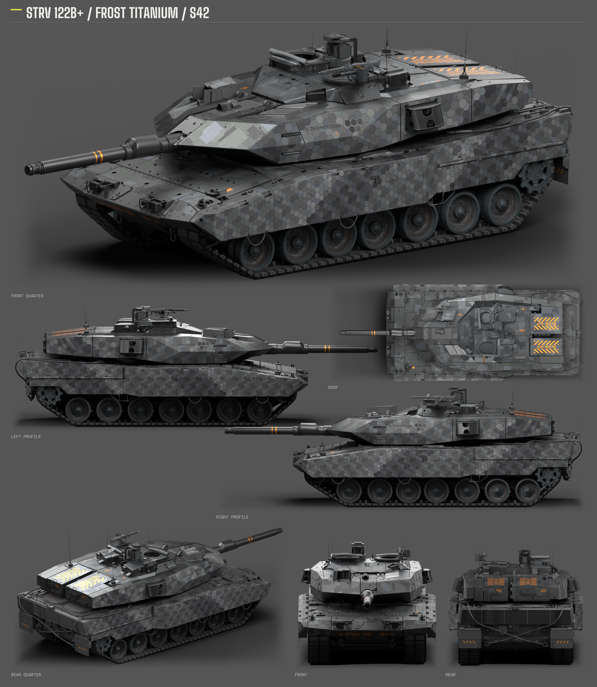
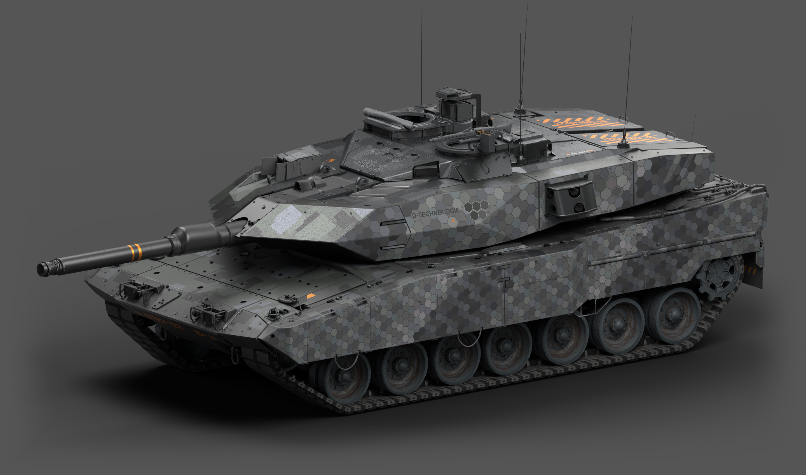
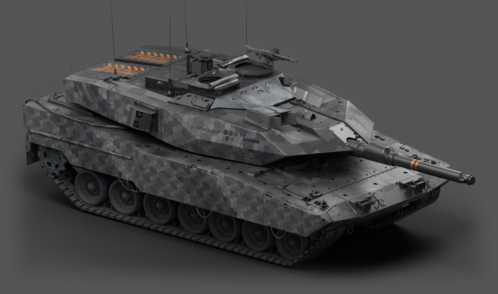
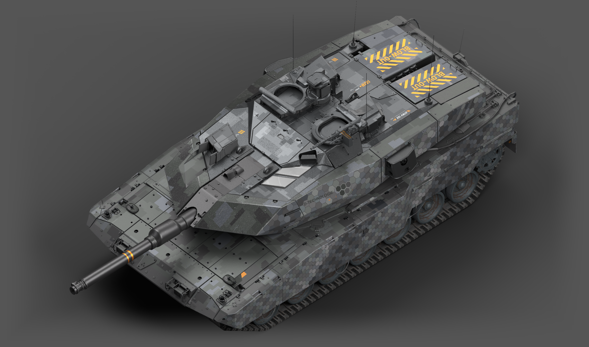

# Strv 122B+「霜钛 / Frost Titanium」· S42

## 中文简介（150字）

霜钛是专门为战雷瑞典Strv122B+制作的银灰工业风涂装。半哑光金属搭配阶梯数码斑块、分区蜂窝、车型标识及橙色点缀，呈现冷峻的机械质感。炮塔顶部两块板面和折边移植终末地A7V原材质，光泽与金属反射已获游戏内确认。完整保留原生模型和UV，解压至UserSkins目录后刷新列表，选择对应涂装即可使用。

## English

Frost Titanium is a silver-gray industrial livery for Sweden’s Strv 122B+ in War Thunder. Semi-matte metal combines with stepped digital blocks, segmented honeycomb panels, vehicle markings, and orange accents. The two turret roof plates and their folded edges use materials transferred from the original Endfield Leopard 2A7V skin; their gloss and metallic response have been confirmed in game. The native model and UV layout remain intact. Extract the folder into UserSkins, refresh the custom camouflage list, and select Strv122Bplus_Shuangtai_S42.

<!-- standard-showcase -->
## 标准七视图 / Standard seven views

斜前、斜后、左侧、右侧、顶部、正前、正后七个方向；统一灰底与标准棚光。

## 整车大图 / Full-vehicle images

三张独立大图均为 2880 × 1700。展示图使用发布包最终 DDS，在原生模型上离线渲染。

Three independent 2880 × 1700 images, rendered offline from the native model with the final published DDS.

- [标准七视图与三张整车大图 ZIP](https://github.com/IcyRyna/war-thunder-liveries/releases/download/works/strv122bp-shuangtai-s42/current/strv122bp-shuangtai-s42-showcase.zip)
- [标准七视图 PNG](https://github.com/IcyRyna/war-thunder-liveries/releases/download/works/strv122bp-shuangtai-s42/current/strv122bp-shuangtai-s42-seven-views.png)
- [斜前整车大图 PNG](https://github.com/IcyRyna/war-thunder-liveries/releases/download/works/strv122bp-shuangtai-s42/current/strv122bp-shuangtai-s42-hero-front.png)
- [另一侧整车大图 PNG](https://github.com/IcyRyna/war-thunder-liveries/releases/download/works/strv122bp-shuangtai-s42/current/strv122bp-shuangtai-s42-hero-opposite.png)
- [顶部整车大图 PNG](https://github.com/IcyRyna/war-thunder-liveries/releases/download/works/strv122bp-shuangtai-s42/current/strv122bp-shuangtai-s42-hero-overview.png)
<!-- /standard-showcase -->

## 下载 / Download

[游戏涂装 / Game skin ZIP](https://github.com/IcyRyna/war-thunder-liveries/releases/download/works/strv122bp-shuangtai-s42/current/strv122bp-shuangtai-s42-skin.zip) · [发布页 / Release](https://github.com/IcyRyna/war-thunder-liveries/releases/tag/works/strv122bp-shuangtai-s42/current)

- ZIP：88,641,654 bytes
- 解压 / Unpacked：173,305,701 bytes
- 文件 / Files：29
- SHA-256：`04ba75e19a8bf8e2bb62e9092890b55e1c1b2614bd1e08e1252efa6ba9b37817`

## 安装 / Installation

1. 下载游戏 ZIP，将 `Strv122Bplus_Shuangtai_S42` 整个文件夹放入客户端 `UserSkins/`。
2. 在瑞典 Strv 122B+ 上刷新自定义涂装列表，并选择该涂装。
3. 更新时覆盖同名文件夹；本包无需额外模型或 UV 组件。

Extract `Strv122Bplus_Shuangtai_S42` into the client’s `UserSkins/` folder, refresh custom camouflages on the Swedish Strv 122B+, and select it. Overwrite the same folder when updating. No additional model or UV component is required.

## 验证 / Validation

原生分辨率与完整 mip 保留，DDS 全级回读、包体与 CRC 校验通过。顶部板面及折边的原材质已获游戏内确认；本发布包进行了块压缩与离线模型检查，未另作压缩包的游戏内二次确认。

Native resolution and complete mip chains are retained. DDS readback, archive CRC and size checks passed. The source roof material was confirmed in game. The compressed distribution was checked offline and has not received a separate in-game confirmation.

## 来源与使用范围 / Credits and use

整体方案与本车布局：IcyRyna。顶部板件的 C/N/AO 材质逐面适配自 [HK416の午夜福音的 Leopard 2A7V ENDFIELD 原作](https://live.warthunder.com/post/1162771/en/)。游戏模型、原始贴图与原作素材的权利归各自权利人；仓库脚本的 MIT 许可不覆盖这些素材。详见[许可说明](../../../docs/licensing.md)。

Design and vehicle-specific layout: IcyRyna. Roof-plate C/N/AO materials are adapted from HK416の午夜福音’s original Leopard 2A7V ENDFIELD skin, linked above. Game assets and third-party materials retain their respective rights; the repository’s MIT license for scripts does not relicense them.
