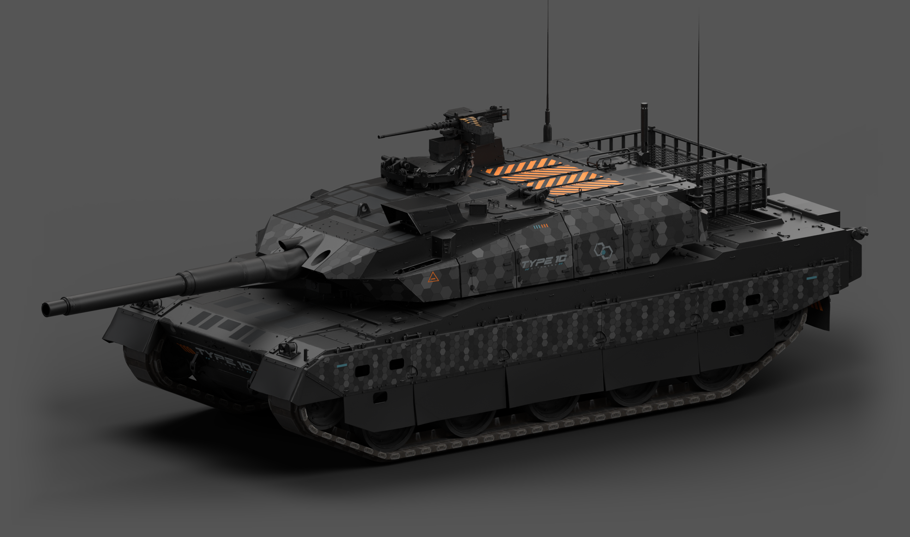
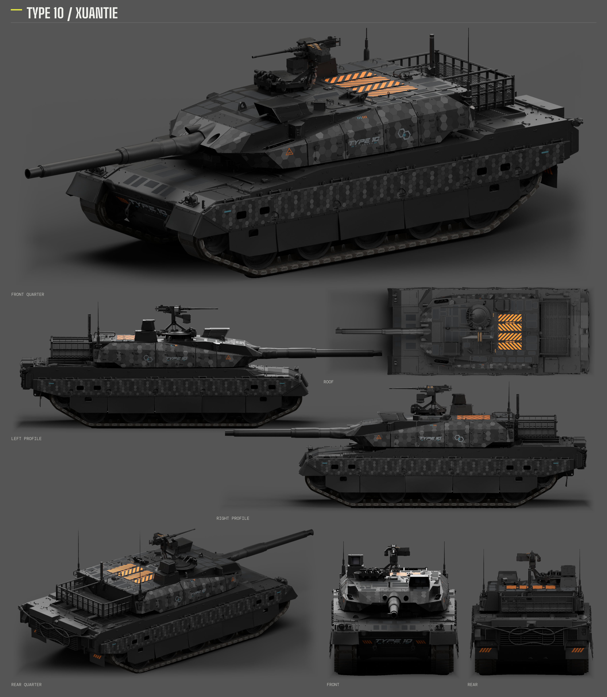
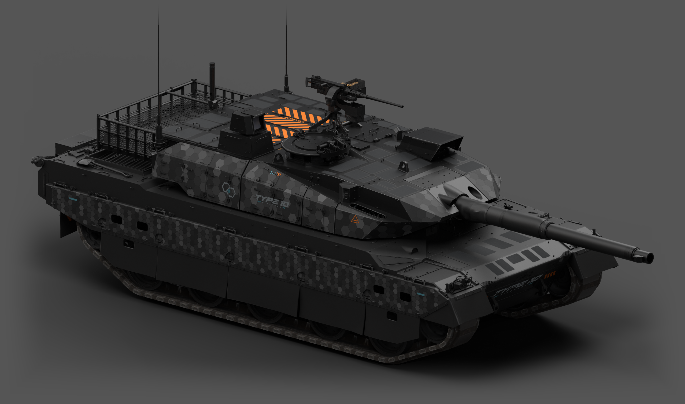
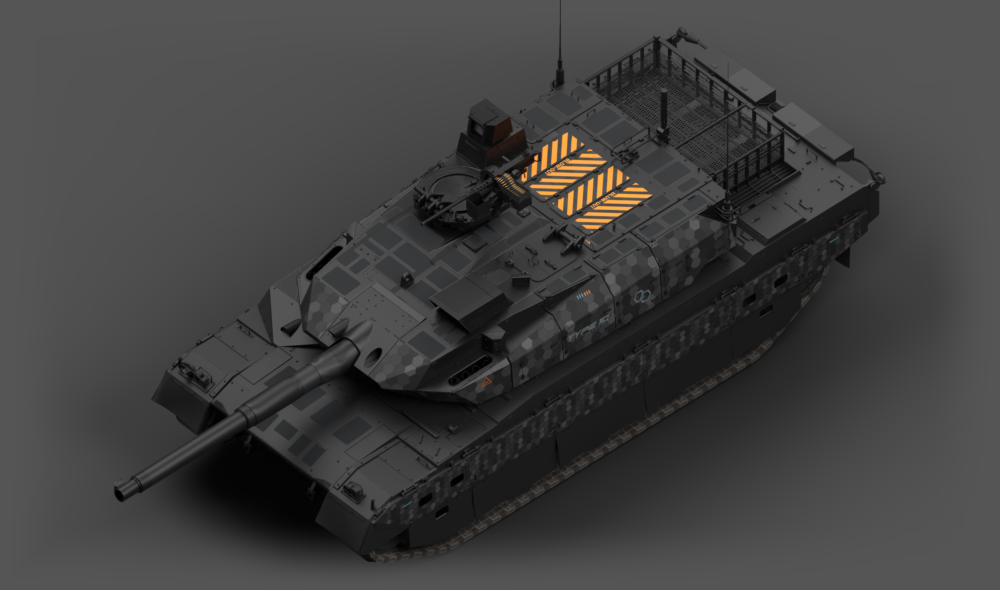

# 10式「玄铁」· S42 / Type 10 “Xuantie” · S42

<!-- interactive-preview:start -->

**[打开作品介绍与交互式 3D 预览](https://icyryna.github.io/war-thunder-liveries/works/type10-xuantie-s42/)**

[Open the introduction and interactive 3D preview](https://icyryna.github.io/war-thunder-liveries/works/type10-xuantie-s42/)

可拖动旋转、切换视角，检查颜色、金属反射与磨砂凹凸。
Rotate the model, switch views, and inspect the colors, metallic response, and fine anti-slip surface.

<!-- interactive-preview:end -->

适用于《战争雷霆》日本陆军 **10式主战坦克（Type 10 / Hitomaru）** 的炭灰工业涂装。由 IcyRyna 发布，沿用本车原生模型与 UV，按真实装甲面安排图形和材质。

深炭灰金属底色搭配不同尺度的蜂窝：炮塔正面、侧后和侧裙形成连续的工业纹样，首上与炮塔顶部保留深色细磨砂防滑区。炮塔侧面以青白身份图形和橙色警示点缀；弹药舱顶部的两块纵向 **BLOW-OUT** 标识分别贴合泄压盖板。首下中央补入 **TYPE 10 / HITOMARU** 字标，顶部 V 形装饰和多余细线已移除。

**状态：已获准发布。** 已按游戏截图反馈迭代，最终游戏 ZIP 的全部 19 个运行文件与 Steam 安装目录逐文件校验一致；Composa 分层工程及最终 DDS 的 Blender 展示已核对。展示图用于检查设计，材质效果以实际游戏光照为准。



## 下载

- [游戏涂装 ZIP](https://github.com/IcyRyna/war-thunder-liveries/releases/download/works/type10-xuantie-s42/v21/type10-xuantie-s42-game.zip)
- [可编辑工程与源码 ZIP](https://github.com/IcyRyna/war-thunder-liveries/releases/download/works/type10-xuantie-s42/v21/type10-xuantie-s42-source.zip)
- [七视图与三张整车大图 ZIP](https://github.com/IcyRyna/war-thunder-liveries/releases/download/works/type10-xuantie-s42/v21/type10-xuantie-s42-showcase.zip)
- [七视图原尺寸 PNG](https://github.com/IcyRyna/war-thunder-liveries/releases/download/works/type10-xuantie-s42/v21/type10-xuantie-s42-seven-views.png)
- [斜前整车大图 PNG](https://github.com/IcyRyna/war-thunder-liveries/releases/download/works/type10-xuantie-s42/v21/type10-xuantie-s42-hero-front.png)
- [另一侧整车大图 PNG](https://github.com/IcyRyna/war-thunder-liveries/releases/download/works/type10-xuantie-s42/v21/type10-xuantie-s42-hero-opposite.png)
- [顶部整车大图 PNG](https://github.com/IcyRyna/war-thunder-liveries/releases/download/works/type10-xuantie-s42/v21/type10-xuantie-s42-hero-overview.png)

游戏包只含运行所需配置和纹理。源码提供车体、炮塔 Composa 原生分层工程、原生 UV 与模型输入、纹理素材、重建脚本和配套 Blender 展示工程。展示包是 **一张 3600×4137 七视图板和三张 2880×1700 独立整车 PNG**。

## 七视图



## 另一侧与顶部





## 安装与更新

1. 下载「游戏涂装 ZIP」并解压。
2. 将整个 `Type10_Xuantie_S42` 文件夹放到 `<War Thunder>/UserSkins/`，使 `.blk` 与 DDS 位于该文件夹内。
3. 在 10式的自定义涂装中刷新并选择 `Type10_Xuantie_S42`。更新时覆盖同名目录，再刷新或重新选择。

这是普通客户端的 UserSkins 涂装；不需要额外替换模型组件。游戏 ZIP 不包含展示图片，GitHub 自动生成的 Source code 仓库快照也不等于完整可编辑源码附件。

## 继续编辑

源码解压后，Composa 工程位于 `editor/v1-rgb/`，Blender 棚拍工程位于 `editor/showcase-standard/`；现用运行文件位于 `packaging/v21/Type10_Xuantie_S42/`。安装 Python、NumPy 和 Pillow 后可从源码根目录重建游戏包：

```powershell
python -B tools/build_game.py --root . --out <新输出目录> --report <新报告文件>
```

标准展示使用 Blender 4.5.14 与 `tools/render_standard_showcase.py`，具体执行方式见源码内 README。打包 N 图的 R 为反向粗糙度／光泽，B 为金属度，G/A 为法线；A 通道不是透明度。

## 来源与许可

炭灰工业设计参考 [Fying_ 的 SPECTRE42（WT Live 1192186）](https://live.warthunder.com/post/1192186/en/)，制作方法和警示图形沿用本仓库[勒克莱尔 AZUR 的 SPECTRE42 工程](../leclerc-azur-spectre42/README.md)，并按 10式的原生表面重新排布。车型字标、蜂窝、细磨砂及版面按本车制作；不表示参考作者参与了本作品制作。

游戏模型、UV 和原始游戏资源归其各自权利人。自编脚本、涂装纹理、参考素材的授权范围分别处理；公开下载不为来源素材增加授权。详见[仓库许可说明](../../../docs/licensing.md)。


---

## English

**Type 10 “Xuantie” · S42** is a charcoal industrial skin for the **Japanese Type 10 / Hitomaru main battle tank in War Thunder**, published by IcyRyna. It uses the vehicle's original model and UV layout, with graphics and materials arranged for its actual armor surfaces.

### Design

The dark charcoal metallic finish combines honeycomb patterns at different scales across the turret front, turret sides and rear, and side skirts. The upper glacis and turret roof retain dark, fine-grained anti-slip panels. Cyan-white identity graphics and small orange warnings accent the turret sides. Two longitudinal **BLOW-OUT** markings fit the ammunition compartment's separate roof relief panels, and a centered **TYPE 10 / HITOMARU** wordmark identifies the lower glacis. The roof V motif and unwanted guide lines have been removed.

### Status and verification

**Authorized for publication.** The skin was iterated using in-game screenshot feedback. All **19 runtime files** in the published game ZIP match the current Steam installation byte for byte. The Composa layered projects and Blender presentation using the final DDS files were checked. The presentation is a design reference; the actual material appearance depends on in-game lighting.

### Downloads

- [Game skin ZIP](https://github.com/IcyRyna/war-thunder-liveries/releases/download/works/type10-xuantie-s42/v21/type10-xuantie-s42-game.zip)
- [Editable project and source ZIP](https://github.com/IcyRyna/war-thunder-liveries/releases/download/works/type10-xuantie-s42/v21/type10-xuantie-s42-source.zip)
- [Seven-view board and three full-vehicle images ZIP](https://github.com/IcyRyna/war-thunder-liveries/releases/download/works/type10-xuantie-s42/v21/type10-xuantie-s42-showcase.zip)
- [Full-resolution seven-view board PNG](https://github.com/IcyRyna/war-thunder-liveries/releases/download/works/type10-xuantie-s42/v21/type10-xuantie-s42-seven-views.png)
- [Front-quarter full-vehicle PNG](https://github.com/IcyRyna/war-thunder-liveries/releases/download/works/type10-xuantie-s42/v21/type10-xuantie-s42-hero-front.png)
- [Opposite-side full-vehicle PNG](https://github.com/IcyRyna/war-thunder-liveries/releases/download/works/type10-xuantie-s42/v21/type10-xuantie-s42-hero-opposite.png)
- [Overhead full-vehicle PNG](https://github.com/IcyRyna/war-thunder-liveries/releases/download/works/type10-xuantie-s42/v21/type10-xuantie-s42-hero-overview.png)

The game ZIP contains only the configuration and textures needed by the game. The editable source attachment includes the hull and turret Composa projects, original UV and model inputs, texture assets, rebuild scripts, and the matching Blender studio project. The showcase ZIP contains **one 3600×4137 seven-view board and three separate 2880×1700 full-vehicle PNGs**.

### Installation and updates

1. Download and extract the **Game skin ZIP**.
2. Copy the complete `Type10_Xuantie_S42` folder into `<War Thunder>/UserSkins/`, keeping the `.blk` and DDS files together inside it.
3. On the Type 10 customization screen, refresh the user-skin list and select `Type10_Xuantie_S42`. To update, overwrite the same folder and refresh or reselect it.

This is a normal-client UserSkins package and requires no model replacement. Presentation images are separate from the game ZIP. GitHub's automatically generated **Source code** archive is a repository snapshot, not the full editable project attachment.

### Editing and rebuilding

After extracting the source attachment, the Composa projects are in `editor/v1-rgb/`, the Blender studio project is in `editor/showcase-standard/`, and the current runtime files are in `packaging/v21/Type10_Xuantie_S42/`. With Python, NumPy and Pillow installed, run from the extracted source root:

```powershell
python -B tools/build_game.py --root . --out <new-output-directory> --report <new-report-file>
```

The studio presentation uses Blender 4.5.14 and `tools/render_standard_showcase.py`; the source README describes the workflow. In the packed N texture, R stores inverted roughness/gloss, B stores metallicity, and G/A store the normal components. **The N texture's A channel is data, not opacity.**

### Sources and licensing

The visual style references [Fying_'s SPECTRE42, WT Live 1192186](https://live.warthunder.com/post/1192186/en/). The production method and warning graphics build on this repository's [Leclerc AZUR SPECTRE42 project](../leclerc-azur-spectre42/README.md), adapted to the Type 10's original surfaces. Vehicle lettering, honeycomb, fine anti-slip details, and composition were prepared for this vehicle. This does not imply that the reference author participated in making this skin.

Game models, UVs, and original game resources remain the property of their respective rights holders. Self-written code, livery textures, and reference assets have separate licensing scopes; public availability does not grant new rights to source material. See the [repository licensing notes](../../../docs/licensing.md).
