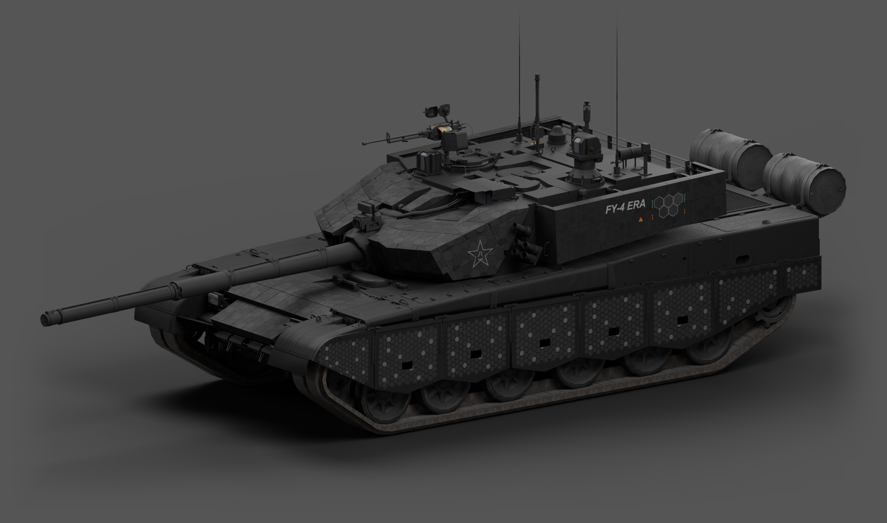
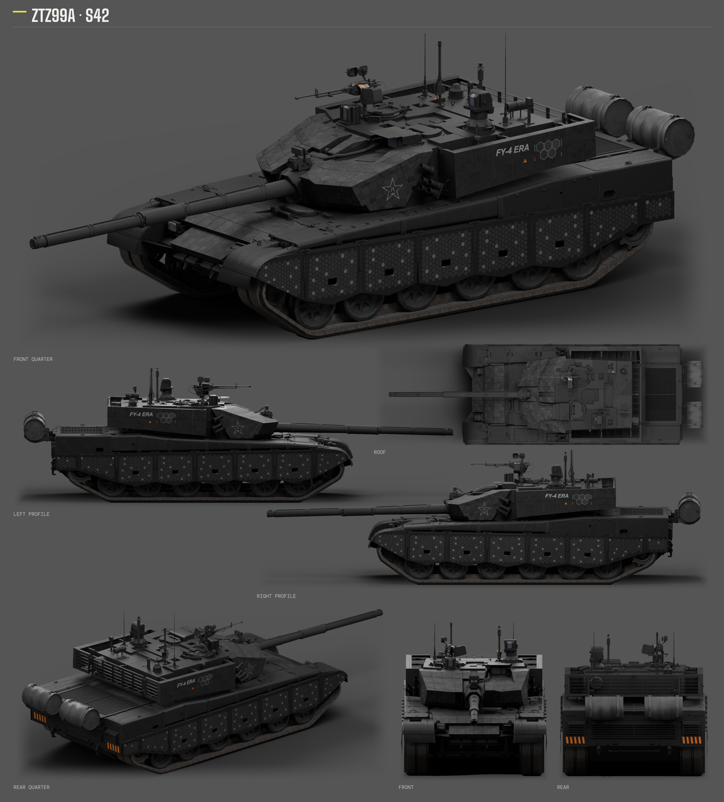
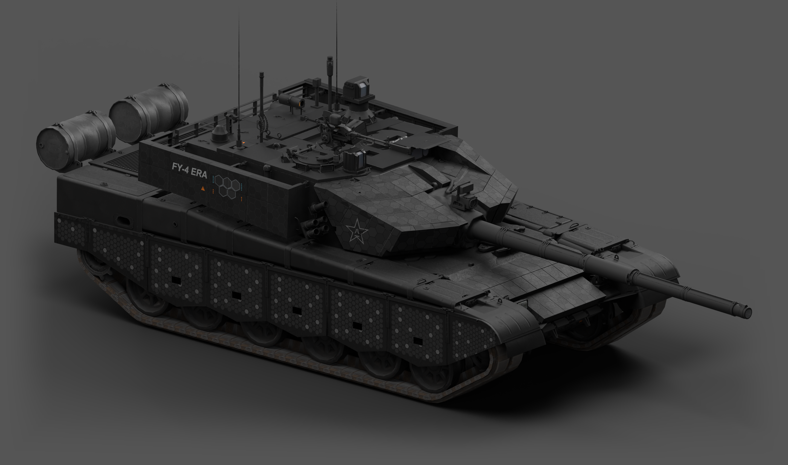
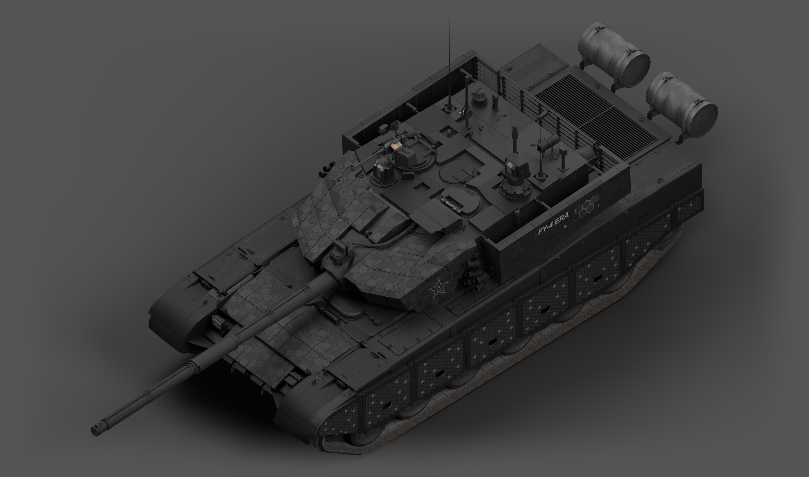

# ZTZ99A · SPECTRE42「磨砂炭灰」

<!-- interactive-preview:start -->

**[打开本套涂装的介绍与交互式 3D 预览](https://icyryna.github.io/war-thunder-liveries/works/ztz99a-spectre42/)**

可拖动旋转、切换视角，并检查原生颜色、反射与磨砂凹凸。

<!-- interactive-preview:end -->

这套 ZTZ99A 专用涂装以炭灰与相近灰阶分块构成主体，侧裙连续细密蜂窝、炮塔局部较大蜂窝和 FY-4 ERA 图形标注形成层次。顶部采用小尺寸低对比深色细线，板面与舱盖增强金属光泽，同时保留细磨砂、结构缝和 AO；后部两侧以克制的橙黑短条呼应。

**状态：已获准发布。配套原生模型、最终 DDS、全部 mip 与独立重建已核验；游戏内视觉仍待实际客户端复核。**



## 下载

- [游戏涂装与配套 WTG 模型组件 ZIP](https://github.com/IcyRyna/war-thunder-liveries/releases/download/works/ztz99a-spectre42/v55/ztz99a-spectre42-game.zip)
- [完整可编辑工程与源码 ZIP](https://github.com/IcyRyna/war-thunder-liveries/releases/download/works/ztz99a-spectre42/v55/ztz99a-spectre42-source.zip)
- [七视图原尺寸 PNG](https://github.com/IcyRyna/war-thunder-liveries/releases/download/works/ztz99a-spectre42/v55/ztz99a-spectre42-seven-views.png)
- [斜前整车大图 PNG](https://github.com/IcyRyna/war-thunder-liveries/releases/download/works/ztz99a-spectre42/v55/ztz99a-spectre42-hero-front.png)
- [另一侧整车大图 PNG](https://github.com/IcyRyna/war-thunder-liveries/releases/download/works/ztz99a-spectre42/v55/ztz99a-spectre42-hero-opposite.png)
- [顶部整车大图 PNG](https://github.com/IcyRyna/war-thunder-liveries/releases/download/works/ztz99a-spectre42/v55/ztz99a-spectre42-hero-overview.png)

图片独立提供，游戏 ZIP 只含运行所需配置、纹理和匹配模型组件。源码提供 Composa 分层工程、完整 PNG、原生 UV、可独立打开的 GLB 和逐字节重建脚本。

## 七视图



## 另一侧与顶部





## 安装与源码

本套包含经适配的 WTG 原生模型组件，模型与扩展纹理必须成套使用。将游戏 ZIP 的 `content/` 与 `UserSkins/` 按原结构合入对应 WTG 隔离客户端根目录，在 ZTZ99A 上选择 `99A_SPECTRE42`。这不是只复制 UserSkins 即适用的普通客户端包；恢复默认时一并恢复原模型。

源码中的 `editor/` 保存实际分层组装和重开核对过的 CMPS；`textures/` 保存当前 PNG 与透明细线层；`model/model.glb` 可独立打开。安装 Python、Pillow、NumPy 后运行：

```powershell
python -B build/rebuild_runtime.py --out 新目录
```

该命令从当前 PNG 与独立运行输入重建并校验完整 13 个运行文件。打包 N 的 R 为光泽、B 为金属度、G/A 为法线数据；N.A 不作为透明覆盖处理。

风格参考：[Fying_ 的 SPECTRE42 / WT Live 1192186](https://live.warthunder.com/post/1192186/en/)。游戏资源、参考素材与自编代码的许可范围见[仓库许可说明](../../../docs/licensing.md)。网页反射为 PBR 近似，最终以实际游戏材质为准。
