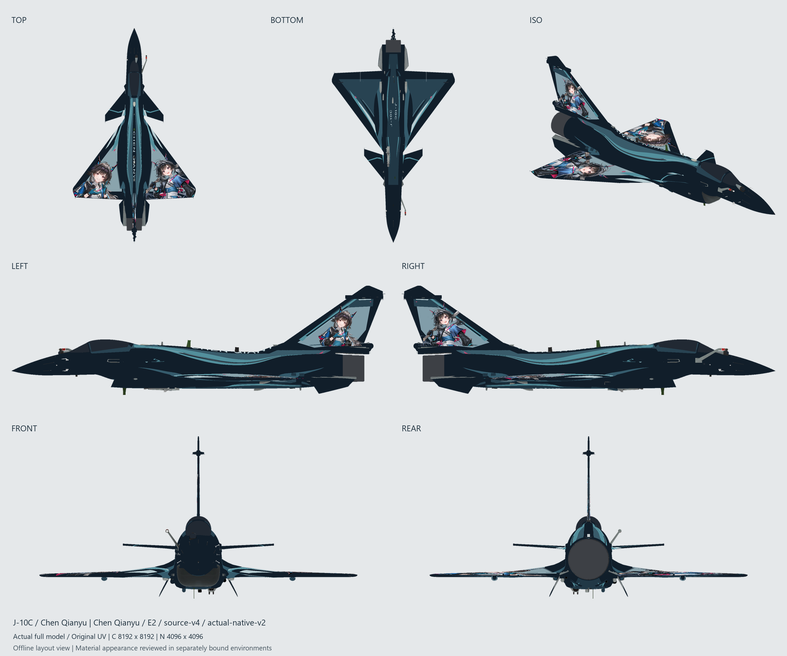

# J-10C 陈千语 · 早期风格（重修版）

| 项目 | 内容 |
| --- | --- |
| 机型 | J-10C |
| 角色 | 陈千语 |
| 风格 | 早期风格（重修版） |
| 当前版本 | [v1](https://github.com/IcyRyna/war-thunder-liveries/releases/tag/works/j10c-chen-qianyu-repaired/v1) |
| 日期 | 2026-10-16 |
| 状态 | 待评价 |
| 说明 | 线条与质感重修候选，8K，未进游戏验证。 |
| 工作区任务 | `war-thunder-skins/assignments/chen-repair-20261015` |

## 文件（在 Release 里下载）

| 文件 | 类型 | 大小 | SHA-256 |
| --- | --- | --- | --- |
| `J10C_ChenQianyu_Repaired_8K_TGA.zip` | 游戏包（TGA） | 26.8 MB | `6ba0744133cc1edd…` |
| `J10C_ChenQianyu_Repaired_8K_DDS_RGBA8.zip` | 游戏包（DDS） | 39.4 MB | `0d106cfae1921ba1…` |
| `J10C_ChenQianyu_Repaired_8K_Editable.zip` | 可编辑工程 | 133.3 MB | `e2876757ae56a95e…` |

## 安装

解压游戏包，把里面的文件夹放进 War Thunder 的 `UserSkins/`，在机库里选这个涂装。TGA 和 DDS 两个包装一个即可。

## 版本记录

| 版本 | 日期 | 状态 |
| --- | --- | --- |
| v1 | 2026-10-16 | 待评价 |

角色立绘版权归原作品所有，仅作个人备份，非商业用途。
