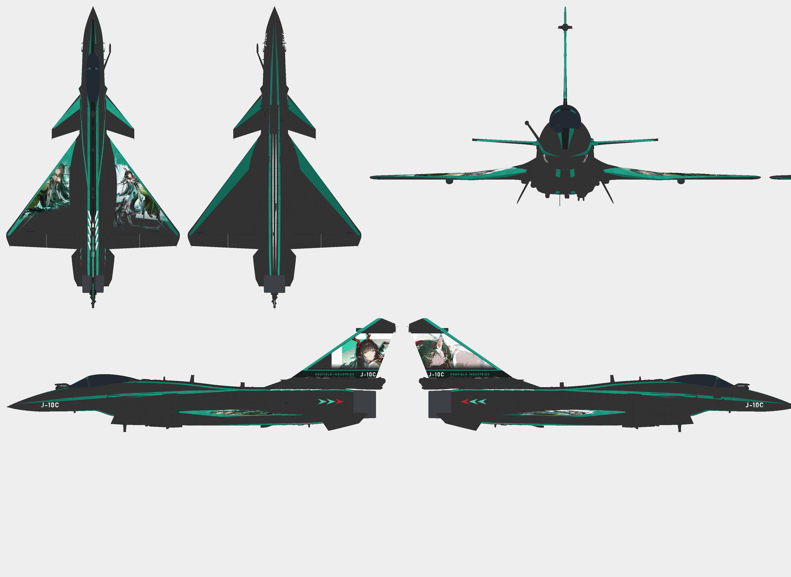

# J-10C 庄方宜 · Akamywek 风格

| 项目 | 内容 |
| --- | --- |
| 机型 | J-10C |
| 角色 | 庄方宜 |
| 风格 | Akamywek 风格 |
| 当前版本 | [v3](https://github.com/IcyRyna/war-thunder-liveries/releases/tag/works/j10c-zhuang-fangyi-akamywek/v3) |
| 日期 | 2026-10-18 |
| 状态 | 待评价 |
| 说明 | 漆面是旧做法（R 108、保留原机法线），机腹有白细针；按 Skill 3.8 规则需要重做材质和白线。 |
| 工作区任务 | `war-thunder-skins/assignments/j10c-zhuang-akamywek-20261018` |

## 文件（在 Release 里下载）

| 文件 | 类型 | 大小 | SHA-256 |
| --- | --- | --- | --- |
| `J10C_ZhuangFangyi_Akamywek_4K_v3.zip` | 游戏包（TGA） | 15.8 MB | `8830856d95729d0f…` |
| `J10C_ZhuangFangyi_Akamywek_v3_Editable.zip` | 可编辑工程 | 39.6 MB | `176d07532cb0fed9…` |

## 安装

解压游戏包，把里面的文件夹放进 War Thunder 的 `UserSkins/`，在机库里选这个涂装。TGA 和 DDS 两个包装一个即可。

## 版本记录

| 版本 | 日期 | 状态 |
| --- | --- | --- |
| v3 | 2026-10-18 | 待评价 |

角色立绘版权归原作品所有，仅作个人备份，非商业用途。
