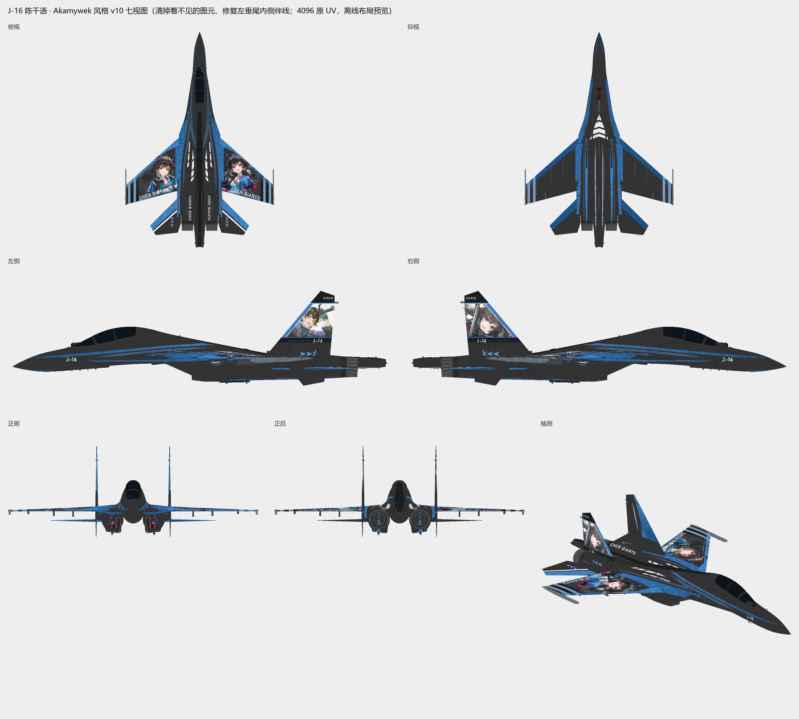

# J-16 陈千语 · Akamywek 风格

| 项目 | 内容 |
| --- | --- |
| 机型 | J-16 |
| 角色 | 陈千语 |
| 风格 | Akamywek 风格 |
| 当前版本 | [v10](https://github.com/IcyRyna/war-thunder-liveries/releases/tag/works/j16-chen-qianyu-akamywek/v10) |
| 日期 | 2026-10-18 |
| 状态 | 已认可 |
| 说明 | 用户 2026-10-18 认可（“可以v10不错”）。漆面仍是 Skill 3.8 之前的旧做法（偏哑光、保留原机法线）。 |
| 工作区任务 | `war-thunder-skins/assignments/j16-chen-akamywek-20261017` |

## 文件（在 Release 里下载）

| 文件 | 类型 | 大小 | SHA-256 |
| --- | --- | --- | --- |
| `J16_ChenQianyu_Akamywek_4K.zip` | 游戏包（TGA） | 13.3 MB | `a4c2ac8e7f2e67d7…` |
| `J16_ChenQianyu_Akamywek_Editable.zip` | 可编辑工程 | 42.0 MB | `9b1d04c1a77010da…` |
| `J16_ChenQianyu_Akamywek.cmps` | 可编辑工程 | 11.2 MB | `f58355c6ca6cdebe…` |

## 安装

解压游戏包，把里面的文件夹放进 War Thunder 的 `UserSkins/`，在机库里选这个涂装。TGA 和 DDS 两个包装一个即可。

## 版本记录

| 版本 | 日期 | 状态 |
| --- | --- | --- |
| v10 | 2026-10-18 | 已认可 |

角色立绘版权归原作品所有，仅作个人备份，非商业用途。
