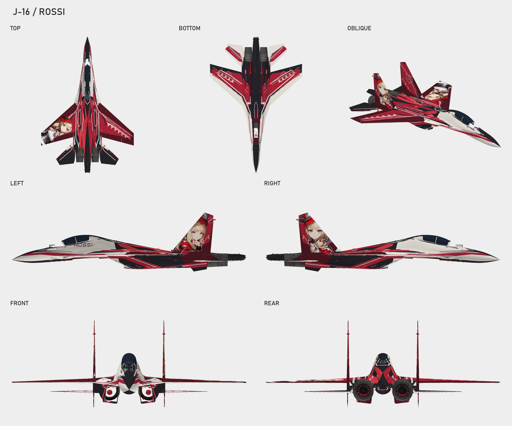

# J-16 Rossi · 早期风格

| 项目 | 内容 |
| --- | --- |
| 机型 | J-16 |
| 角色 | Rossi |
| 风格 | 早期风格 |
| 当前版本 | [v1](https://github.com/IcyRyna/war-thunder-liveries/releases/tag/works/j16-rossi/v1) |
| 日期 | 2026-10-14 |
| 状态 | 已否定 |
| 说明 | 用户否定：清晰度不够（rejected_current_clarity）。只作备份保留。 |
| 工作区任务 | `war-thunder-skins/assignments/j16-rossi-20261014` |

## 文件（在 Release 里下载）

| 文件 | 类型 | 大小 | SHA-256 |
| --- | --- | --- | --- |
| `J16_Rossi_4K.zip` | 游戏包（TGA） | 7.6 MB | `489138eea97de37f…` |
| `J16_Rossi_editable.zip` | 可编辑工程 | 89.6 MB | `37872f201f529966…` |

## 安装

解压游戏包，把里面的文件夹放进 War Thunder 的 `UserSkins/`，在机库里选这个涂装。TGA 和 DDS 两个包装一个即可。

## 版本记录

| 版本 | 日期 | 状态 |
| --- | --- | --- |
| v1 | 2026-10-14 | 已否定 |

角色立绘版权归原作品所有，仅作个人备份，非商业用途。
