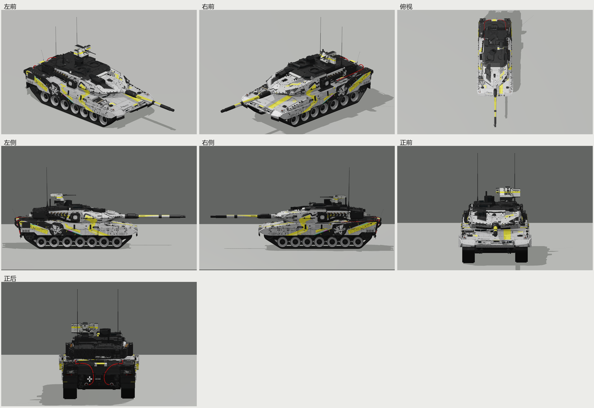

# Leopard 2A7HU ENDFIELD

当前版本：[v3](https://github.com/IcyRyna/war-thunder-liveries/releases/tag/works/leopard2a7hu-endfield/v3)（2026-10-20）。状态：**待评价**。

基于 [HK416の午夜福音的 Leopard 2A7V ENDFIELD 原作](https://live.warthunder.com/post/1162771/en/) 适配。车体和炮管直接保留作者原纹理；HU 专属炮塔、附加件、遥控武器站沿原作黑白黄画风制作。原作备份见 [参考作品](../../references/leopard2a7v-endfield/README.md)。

本版修正 HU 顶盖与舱盖边墙的白缝、立杆错色；武器站 ENDFIELD 字标调整为正向完整显示，清理压纹和支架的旧化脏边，并保留黑色紧固件。武器站新绘制贴图为 4096×2048；主炮塔顶盖细线保持宽度和疏密，RGB 仅提高 0–6。

已检查 15 张 DDS 与 BLK 的 HU 模型资源引用、透明通道、PNG→DDS 像素一致性及 ZIP 往返；七视图读取实际交付 DDS。可编辑源包在独立临时目录重建的 15 张 DDS 和 BLK 均逐字节一致。实际游戏内效果仍待检视；离线预览使用静态原模型和近似光照，部分附属材质使用默认值。

Release 附件：游戏包与可编辑源包。游戏包解压至 War Thunder/UserSkins，再在豹 2A7HU 上选择该涂装。

| 文件 | SHA-256 |
| --- | --- |
| Leopard2A7HU_ENDFIELD_v3.zip | `80e3158942d571ad60c5680fed7c996762908089a174e3b0c822a93cb0cc4762` |
| Leopard2A7HU_ENDFIELD_v3_editable.zip | `f3cac35a15ad73f8094bf17e91af04d66358e6ab9d616706c26056e5154dfeb3` |

这是原作的衍生适配，未冒充原作者作品。此版本未获得用户认可。
